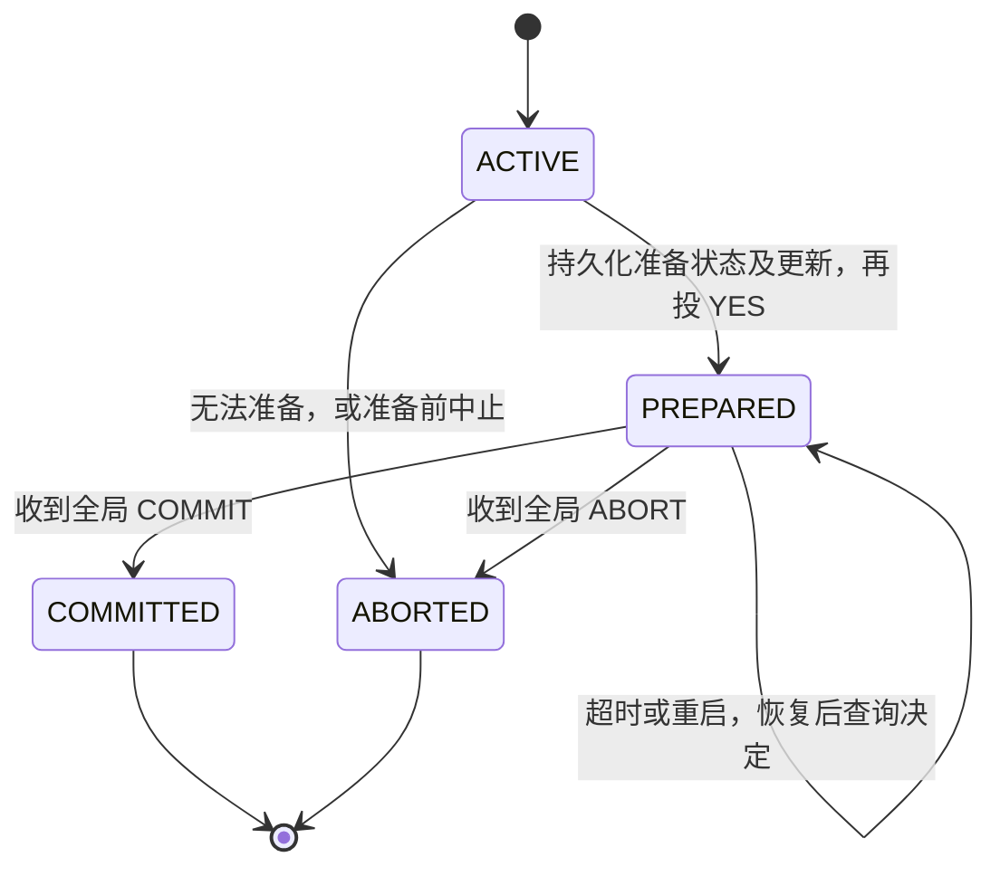

# LEC 10：多站点原子性与复制（Multi-site Atomicity and Replication）

> 课程：SE3331 / CSE-fa26  
> 课件：[Consistency under partial failure: 2PC & replicated state machine](../lectures/LEC-10-Multi-site-Atomicity-and-Replication/consistency-under-partial-failure-2pc-replicated-state-machine.pdf)  
> 页码约定：「讲义页」指幻灯片右下角编号；PDF 共 197 页，主体对应讲义页 1–43，包含目录、过渡页和动画展开页。本文合并重复展开页，按问题推进整理。  
> 「补充理解」「表述边界」「课件校正」用于区分课件内容与进一步说明。流程和状态机均为教学模型；默认节点遵守协议，可能崩溃、重启或失联，已完成的持久化写入可在重启后恢复，不讨论拜占庭故障或所有持久副本永久丢失。

## 1. 本讲主线：有些机器停了，其他机器还在运行

对应讲义页 2–3、17、24，PDF 第 3–8、80、98 页。

[LEC 7](LEC-7-All-or-nothing-atomicity.md) 讨论单机崩溃后的全有或全无；[LEC 8](LEC-8-Before-or-after-atomicity.md) 和 [LEC 9](LEC-9-More-on-before-or-after-atomicity.md) 讨论并发事务如何正确执行。本讲把事务放到多台机器上，加入 **partial failure（部分故障）**：一台机器已经重启，另一台还在运行；有的消息到达，有的消息丢失。

课件的例子是发工资：Alice 的账户在 A–M 服务器，Zack 的账户在 N–Z 服务器。

```text
pay_salary(bank, accounts, amount):
    for account in accounts:
        deposit(bank, account, amount)

一个全局事务：
    A–M 服务器：给 Alice 存钱
    N–Z 服务器：给 Zack 存钱
```

若一个站点提交、另一个站点中止，这次发工资就只完成了一部分。目标是：**所有参与站点最终遵循同一个决定，要么全部提交，要么全部中止。**

```text
多个站点各有本地事务，可能独立故障
          ↓
2PC：先收集提交承诺，再形成统一决定
          ↓
日志：让承诺和决定在重启后仍有效
          ↓
协调者失联：保证不做错，但参与者可能一直等待
          ↓
CAP：分区时，强一致性与所有节点持续服务存在冲突
          ↓
复制状态机：同样的初始状态 + 同序输入 + 确定性执行
          ↓
主备复制：统一排序，再处理主节点失效与切换
          ↓
View + quorum：限制旧主继续服务，并保住已确认的历史
          ↓
View server 自己也可能故障 → 后续的 Paxos / Raft
```

### 1.1 两个不同层次的问题

| 层次 | 多台机器存什么？ | 需要保证什么？ |
| --- | --- | --- |
| 多站点事务 | 不同站点持有事务涉及的不同数据，例如不同账户 | 各站点对同一事务作出一致的提交或中止决定 |
| 数据／服务复制 | 多个副本保存同一逻辑服务的状态 | 副本遵循一致的操作历史，故障切换后不丢失已确认操作 |

**2PC 和复制可以组合，但解决的不是同一个问题。** 一个跨分片事务可以使用 2PC，而每个分片及协调者又各自通过复制提高可用性。

### 1.2 超时只说明没有及时收到消息

```text
没收到回复，可能是：
    对方崩溃了
    请求丢失了
    回复丢失了
    网络分区了
    对方或网络只是很慢
```

因此，**timeout 不能直接证明“对方没有执行”或“对方已经死亡”。** 本讲的恢复和主备切换都必须在这种不确定性下保持正确。

## 2. 2PC：先准备，再决定

对应讲义页 4、9–10，PDF 第 9–15、46–55 页。

**Two-phase commit（两阶段提交，2PC）**把全局事务的提交拆成两个阶段。

| 角色 | 职责 |
| --- | --- |
| Client | 发起事务，最后请求提交并等待结果 |
| Coordinator（协调者） | 收集所有参与者的投票，形成并记录全局决定 |
| Worker / participant（参与者） | 执行本地部分，准备好恢复信息，按全局决定提交或中止 |

课件在进入提交协议前，假设事务的业务操作已经执行到可以准备提交的位置。此时本地修改仍未被当作独立成功的事务发布。

### 2.1 Phase 1：prepare / vote

1. 协调者向所有参与者发送 `PREPARE(txid)`。
2. 每个参与者检查自己能否完成本地事务，并保留必要的并发控制资源。
3. 能够提交的参与者先持久化 **PREPARED 状态及足够的更新／恢复信息**，然后回复 `YES`。
4. 不能承诺提交的参与者回复 `NO`。

`YES` 的含义不是“我已经提交”，而是：

> 我已经准备好；即使重启，也会保留这次事务，并遵循之后的全局决定。

**一旦进入 PREPARED，参与者便不能因为等待太久而自行撤回承诺。**

### 2.2 Phase 2：decision

| 协调者看到的情况 | 可以作出的决定 |
| --- | --- |
| 所有参与者都投 `YES` | 可以决定 `COMMIT` |
| 至少一个参与者投 `NO` | 决定 `ABORT` |
| 尚未收齐投票就超时，且没有形成最终决定 | 可以重试；也可以决定 `ABORT` |
| 已经持久化 `COMMIT` | 必须继续完成提交，不能改成中止 |

协调者先把决定持久化，再通知参与者。参与者记录并执行该决定，完成本地提交或中止，释放相应资源。

```text
Client              Coordinator               Worker A              Worker B
  |                       |                        |                     |
  |--- request commit --->|                        |                     |
  |                       |------ PREPARE -------->|                     |
  |                       |------ PREPARE ------------------------------>|
  |                       |                        | persist PREPARED    |
  |                       |                        | + updates           |
  |                       |<------- YES -----------|                     |
  |                       |                        |    persist PREPARED |
  |                       |<------------------------- YES ---------------|
  |                       |                        |                     |
  |                       | persist COMMIT         |                     |
  |                       | ★ global decision      |                     |
  |                       |------ COMMIT --------->|                     |
  |                       |------ COMMIT ------------------------------->|
  |                       |                        | finish locally      |
  |                       |                        |      finish locally |
```

### 2.3 全局提交点在哪里？

本讲的全局提交点是：**协调者将 COMMIT 决定成功写入持久日志。**

它不是以下任意一个时刻：

- 客户端发送“我要提交”。
- 某个参与者准备完成。
- 协调者在内存里收齐 `YES`。
- 第一条 `COMMIT` 消息发出或到达。
- 所有参与者都已经把数据写回主数据文件。

收齐 `YES` 提供了提交的条件，持久化决定才使结果在协调者重启后仍然确定。

**表述边界：**不同节点可以在不同物理时刻收到决定、完成本地提交。2PC 保证它们不能作出相反的最终决定；跨站点读取能否看到一致结果，还依赖隔离协议。不能把 2PC 理解成“所有磁盘在同一纳秒改变”。

课件图中允许协调者已经向客户端返回 `OK`，某个参与者仍在等待重发的决定。该图强调“结果已不可逆”和“全部节点完成清理”不同；具体接口何时回复客户端，需要结合它承诺的可见性和完成语义。

## 3. 为什么单机日志还不够？PREPARED 是关键

对应讲义页 5–6、8–11，PDF 第 16–25、34–58 页。

### 3.1 单机的提交点由本地恢复规则决定

回顾课件简化的 redo-only 模型：

```text
修改先留在内存
    ↓
将完整、可识别的提交日志记录持久化
    ↓
以后再把修改写回主数据文件
```

恢复时，完整提交记录存在就 redo；不存在就认为事务未提交。这里“一次本地日志写入”是简化模型，仍以完整记录可识别、持久化语义可靠为前提。

### 3.2 错误做法：投了 YES，恢复时却按本地未提交中止

课件的反例：

| 步骤 | 协调者 | A–M 服务器 | N–Z 服务器 |
| --- | --- | --- | --- |
| 1 | 请求准备 | 保存本地 redo 信息，回复 `YES` | 保存本地 redo 信息，回复 `YES` |
| 2 | 收到两个 `YES` | 等待 | 崩溃 |
| 3 | 准备决定提交 | 等待 | 重启，发现没有本地 `COMMIT`，清空日志并中止 |
| 4 | 决定并通知 `COMMIT` | 提交 | 已经中止，无法履行之前的承诺 |

问题是：N–Z 服务器虽然记录了数据，却没有保存并正确恢复“我已经承诺等待全局决定”这一状态。

**有 redo 数据，不等于有完整的分布式事务恢复协议。**

### 3.3 两条必须遵守的持久化顺序

```text
参与者：持久化 PREPARED + 恢复信息  →  发送 YES
协调者：持久化 COMMIT / ABORT     →  发送最终决定
```

| 若顺序颠倒 | 可能发生什么？ |
| --- | --- |
| 先发 `YES`，再保存准备状态 | 参与者崩溃后忘记承诺，但协调者可能已经决定提交 |
| 先发 `COMMIT`，再记录决定 | 某个站点已提交，协调者重启后却找不到决定并选择中止 |

这两条顺序共同保证：**任何已经让其他节点据此行动的承诺，本节点重启后都不能忘记。**

### 3.4 参与者状态机



**PREPARED 既不是 COMMITTED，也不是 ABORTED；它表示结果尚未得知，但提交能力已经被承诺。**

补充理解：真实系统还需保存事务标识、协调者信息等恢复元数据。重复消息通过 `txid` 识别，不能把重发的 `COMMIT` 当成“再给账户加一次钱”。

## 4. 按日志和角色分析故障

对应讲义页 7–8、11–15，PDF 第 26–44、56–78 页。

分析故障时先问三件事：

```text
① 哪个角色故障或失联？
② 故障前，哪些状态已经持久化？
③ 现在谁知道最终决定，谁只是知道自己投过 YES？
```

### 4.1 故障处理总表

| 故障场景 | 已知事实 | 正确处理 | 是否可能阻塞？ |
| --- | --- | --- | --- |
| `PREPARE` 消息丢失 | 协调者尚未收齐投票 | 超时重发；未决时也可中止 | 可能等待重试 |
| 参与者在准备完成前崩溃，且没有投出有效 `YES` | 该站点未作出不可撤回的承诺 | 本地未准备事务可中止；协调者收不齐票时可决定中止 | 其他已准备站点等待决定 |
| 参与者已持久化 PREPARED，随后崩溃 | 重启后仍负有遵循决定的义务 | 恢复为 PREPARED，查询协调者 | 是 |
| `YES` 回复丢失 | 参与者可能已准备好，协调者仍缺票 | 协调者可重试或中止；参与者不能自行提交 | 是 |
| `COMMIT` 消息丢失 | 全局 COMMIT 已持久化 | 协调者重发；参与者继续等待或查询 | 是 |
| 协调者在决定持久化前崩溃 | 恢复日志中没有最终决定 | 按课件协议恢复后决定 ABORT 并通知各站点 | PREPARED 参与者等待其恢复 |
| 协调者持久化 COMMIT 后崩溃 | 提交已经不可逆 | 从日志恢复 COMMIT 并重发，补齐提交 | 未收到决定者会等待 |

### 4.2 缺少一张票，为什么可以中止？

例如 A–M 服务器没准备好就崩溃，N–Z 服务器已经 PREPARED：

```text
Coordinator：没收齐 YES → 持久化 ABORT → 通知参与者
A–M：没有准备承诺 → 恢复后中止
N–Z：PREPARED → 收到 ABORT → 中止
```

没有任何站点可以仅凭自己投了 `YES` 就提交，因此此时全局中止仍能保证所有站点一致。

### 4.3 参与者超时，为什么不能同样中止？

对一个 PREPARED 参与者而言，以下两种情况可能完全无法区分：

```text
情况 A：协调者还没决定就崩溃了。
情况 B：协调者已经持久化 COMMIT，通知了其他站点，随后失联了。
```

若它在情况 B 中因超时自行中止，就会与已经提交的站点发生冲突。因此：

> 协调者在尚未作出最终决定时可以选择中止；已准备参与者不能凭自己的超时替协调者作决定。

### 4.4 重启后分别查什么？

| 恢复角色 | 日志状态 | 恢复动作 |
| --- | --- | --- |
| 协调者 | 无最终决定 | 在课件模型中中止未决事务 |
| 协调者 | `COMMIT` | 继续通知提交 |
| 协调者 | `ABORT` | 继续通知中止 |
| 参与者 | `PREPARED`，无最终决定 | 保留恢复信息和必要保护，查询决定 |
| 参与者 | `COMMITTED` | 恢复已提交结果，重复通知按同一事务处理 |
| 参与者 | `ABORTED` | 保持中止，不能因迟到消息重新执行为新事务 |

**课件校正：**讲义页 17 把提交点后故障的恢复概括为“恢复到 PREPARED 再完成事务”。更准确地说，只有尚未记录最终决定的已准备参与者恢复到 PREPARED；协调者恢复自己的决定，已经完成的参与者恢复对应终态。

### 4.5 重试能补送消息，不能重新解释结果

重发是为了让所有节点得知同一个决定。协议需做到：

- 同一事务重复收到 `PREPARE`，返回已有状态对应的结果。
- 同一事务重复收到 `COMMIT`，不会重复执行业务增量。
- 终态不会因迟到的消息被反转。
- 客户端没收到响应时，不能直接断言事务已中止；它可能已经提交。

**补充理解：**这些性质需要事务标识、幂等状态转移和适当的日志保留；仅仅在网络层加一个重试循环并不够。

## 5. 2PC 如何接上 2PL、OCC 和 checkpoint？

对应讲义页 16，PDF 第 79 页。

### 5.1 2PC 与 2PL 不要混淆

| 协议 | 两个阶段是什么？ | 主要解决什么？ |
| --- | --- | --- |
| 2PL：two-phase locking | 增长阶段取得锁；收缩阶段释放锁 | 并发事务的冲突可串行化 |
| 2PC：two-phase commit | 准备投票；发布最终决定 | 多站点的原子提交 |

它们可以一起使用。本地事务不能刚投出 `YES` 就释放所有保护，让别人依赖尚未决定的修改；还需要等全局结果确定，按提交或中止完成本地处理后再释放相关锁。

**表述边界：**“锁持有到最终结果”是这里使用的严格持锁安排，不能倒推成“任何基本 2PL 都自动持锁到提交”。2PC 本身也不自动提供全局可串行化。

### 5.2 OCC：验证通过的依据必须持续有效

课件把验证与提交的协调交给全局协调者。可以理解为：

```text
本地执行，缓冲写入
    ↓
准备阶段完成必要验证，并保留提交所需的保护
    ↓
投 YES，等待全局决定
    ↓
COMMIT：发布修改；ABORT：丢弃修改
```

不能在本地验证完后放弃保护，等待很久后又直接用旧验证结果提交。这与 LEC 9 中“验证和安装必须协调为一个整体”是同一个要求。

**表述边界：**课件此处只给出组合方向，没有完整规定分布式 OCC 的串行化协议。各站点各自验证成功，并不无条件推出整个分布式执行可串行化。

### 5.3 Checkpoint 不能忘记 PREPARED 事务

普通日志回收希望把已经无需重放的旧记录删掉。但一个 PREPARED 事务以后可能收到 `COMMIT`，所以必须继续保留足够的信息履行承诺。

```text
错误：checkpoint 时，看到事务还没 COMMIT 就删掉其全部日志。

正确方向：把未决 PREPARED 事务及其恢复信息纳入 checkpoint，
          或保留相关日志，直到可以安全回收。
```

**回收日志的前提是恢复能力已经被完整替代，而不是“记录已经很旧”。**

## 6. 2PC 的代价：安全可以保住，进展可能停住

对应讲义页 12、14、17、24，PDF 第 59–66、69–76、80、98 页。

| 性质 | 2PC 的表现 |
| --- | --- |
| Safety（安全性） | 在协议和存储假设成立时，不让一个站点最终提交、另一个最终中止 |
| Liveness / availability（进展／可用性） | 已准备参与者可能因为无法获知决定而一直等待 |

PREPARED 参与者等待时，还可能占着锁、版本或其他资源，使后续访问同一数据的事务也停住。因此，协调者的故障影响不一定只局限于一笔事务。

课件版本的 2PC 是 **blocking protocol（可能阻塞的协议）**。阻塞来自信息不足：参与者不知道全局是否已经提交，不能通过“猜一个结果”安全地继续。

**补充理解：**如果其他节点保留了可信的最终决定，参与者可以通过额外恢复协议学习结果；但不能保证每次故障时都能联系到这样的节点。基础 2PC 的阻塞问题仍然存在。

接下来的目标是用复制提高协调者和服务的可用性，使一次机器崩溃不必等待原机器恢复。复制仍然需要处理分区、旧主和状态丢失。

## 7. CAP：网络分区时，不能让两边都随意继续

对应讲义页 18–24，PDF 第 81–98 页。

### 7.1 Network partition 是什么？

**Network partition（网络分区）**指原本能够通信的网络分成了无法正常互通的部分。节点可能全部还活着，各自也能服务附近客户端，只是分区之间的消息无法送达。

课件以数据中心交换机故障、升级和跨区域链路故障说明：不能把“网络一直连通”当作默认保证。

### 7.2 C、A、P 分别关注什么？

| 概念 | 本讲需要把握的含义 |
| --- | --- |
| Consistency | 多个副本表现为一个逻辑对象，讨论 CAP 时需明确所要求的一致性强度 |
| Availability | 请求能否完成；工程上还关心是否在规定时间内完成 |
| Partition tolerance | 分析消息可能跨分区丢失时，系统还能提供哪些保证 |

课件用“CAP 三选二”引入问题，但更有用的问法是：**分区已经发生时，哪些请求必须停止，哪些请求可以在降低一致性要求后继续？**

**课件校正：**CAP 形式化讨论中的 C 是线性一致性，不能直接等同于事务的 all-or-nothing 或 ACID 的 C；A 要求非故障节点收到的请求最终完成，本身不规定固定响应期限。课件的 SLO 截止时间是工程上进一步的要求。参见 [Gilbert 与 Lynch 的原始论文，第 2 节](https://groups.csail.mit.edu/tds/papers/Gilbert/Brewer6.pdf)。

### 7.3 最后一件商品的例子

美国区和欧洲区各保存一份库存副本。两份副本表示同一份全局库存，并不是各自拥有一件独立商品。

```text
初始：全局只剩 1 件，两区副本都显示 stock = 1。
    ↓
两区之间发生网络分区。
    ↓
美国区卖出最后一件，stock = 0，并向用户确认成功。
    ↓
库存更新无法传到欧洲区。
    ↓
欧洲区又收到购买请求。
```

欧洲区面临的选择：

| 行为 | 后果 |
| --- | --- |
| 直接按本地 `stock = 1` 确认购买 | 同一件商品卖两次，破坏库存约束及强一致行为 |
| 等待确认全局库存，或暂停这类请求 | 保住一致性，但该分区不能持续完成购买服务 |

“暂时无法确认库存”与“确认已经售罄”不是同一个结果。不能为了让请求及时返回，就把不知道的事实伪装成确定的业务判断。

**表述边界：**这不是说每笔订单都必须成功。库存确实不足时，按业务语义返回失败是正常服务；因通信中断而无法完成服务，不能仅凭返回了一条错误消息就宣称保住了可用性。

### 7.4 SLO 与 goodput

**SLO（service level objective，服务等级目标）**可以给请求延迟设定目标，例如要求在某个时间窗口内完成。

```text
throughput：单位时间完成多少请求
goodput：单位时间完成、且满足所定义有效性条件的请求数
         本讲特别强调延迟落在 SLO 内的完成请求
```

某服务每秒最终完成很多请求，但大部分都晚于用户能接受的期限，其实际服务质量仍然很差。

### 7.5 如何理解“2PC 是 CP”？

课件用这个标签强调：在无法获得决定时，2PC 选择等待，避免出现半提交。

**表述边界：**这是对“保住正确性、牺牲可用性”的课堂概括，不能由此推出 2PC 单独实现线性一致性。原子提交、事务隔离、复制一致性仍是需要分别建立的保证。

复制可以减少单点崩溃造成的停顿，但不能保证任意分区中的所有节点都持续提供强一致服务。

## 8. 复制的挑战：相同请求，顺序不同也会分叉

对应讲义页 25–28，PDF 第 99–113 页。

复制数据或服务有两个常见目的：

- **性能：**分散请求、提高吞吐量，或让数据更靠近使用者以降低延迟。
- **容错：**某个副本失效后，其他副本仍能接管。

但“给每台机器都发一份请求”不足以保持一致。

### 8.1 两个写请求的反例

```text
C1 发出 write(x = 1)
C2 发出 write(x = 2)

S1 收到顺序：write(x = 2) → write(x = 1) → 最终 x = 1
S2 收到顺序：write(x = 1) → write(x = 2) → 最终 x = 2
```

两个副本没有少执行请求，只是网络交付顺序不同，最终状态就不同。

### 8.2 乐观复制与悲观复制

| 方法 | 基本思路 | 对本讲的启示 |
| --- | --- | --- |
| Optimistic replication（乐观复制） | 允许暂时不一致，以后通过规则协调和收敛 | 适用于应用能够接受这种差异的场景 |
| Pessimistic replication（悲观复制） | 在操作确认和对外可见性上进行协调，维护强一致行为 | 更适合保存 2PC 的承诺和最终决定 |

如果协调者副本一个说 `COMMIT`、另一个说 `ABORT`，等到“最终收敛”时，其他站点可能早已采取不可兼容的行动。所以协调者的关键状态不能任由副本独立决定，再事后合并。

### 8.3 RSM：复制状态机

**Replicated state machine（复制状态机，RSM）**把服务器建模为一个确定性状态机：

```text
new_state, output = Apply(old_state, input)
```

所有副本要得到相同结果，需要三个条件：

1. 从相同的初始状态出发。
2. 执行相同的输入序列，包括相同的顺序。
3. 每一步状态转移是确定的。

课件示例：

```text
初始 x = 5
输入序列：[x += 1, x *= 2]

S1：5 → 6 → 12
S2：5 → 6 → 12
S3：5 → 6 → 12
```

**同序输入 + 确定性执行，才能把“复制整个服务状态”转化为“复制一串操作”。**

表述边界：副本处理速度可以不同；落后副本只是执行了日志的较短前缀。RSM 不要求所有机器每一时刻的内存完全相同，但落后副本不能随意对外提供声称为最新的结果。

## 9. Primary-backup：让主节点统一排序

对应讲义页 29–31，PDF 第 114–127 页。

**Primary-backup（主备复制）**指定一个主节点接收并排列操作，其他副本跟随主节点的顺序。

```text
Client → Primary：请求
Primary：为请求确定顺序和必要的非确定性输入
Primary → Backup：复制有序操作
Backup → Primary：按协议接受并确认
Primary → Client：返回结果
```

### 9.1 主节点的三项职责

| 职责 | 为什么需要它？ |
| --- | --- |
| 为操作排序 | 防止各副本按不同顺序处理请求 |
| 在确认客户端请求前完成所要求的复制 | 避免主节点一倒下，已确认操作就消失 |
| 决定非确定性输入 | 防止副本执行相同代码，却因随机数或时间不同而分叉 |

例如业务逻辑会读取 `random()` 或 `time()`，就不能让各副本自由生成自己的值。应把相关值纳入有序输入，或采用其他能保证相同状态转移的办法。

**表述边界：**“发送给备份后回复”还不够，必须等待满足协议要求的确认。确认代表收到内存、持久化还是其他可靠保存条件，也必须与故障模型一致。

### 9.2 一个主节点不自动等于线性一致

要让服务表现得像单一正确服务器，还需保证：

- 操作顺序与客户端已完成操作的先后约束相容。
- 读请求不能绕过协议，从过时副本读取后却声称是最新值。
- 成功返回的操作在允许的故障和切换后仍保留。
- 旧主不能在新主接管后继续独立确认请求。

这些都是后面需要补齐的部分。

### 9.3 心跳监控：看似直接的切换办法

课件的第一次尝试：

```text
S1 是 primary，定期向 monitor 发送心跳。
monitor 长时间收不到心跳，怀疑 S1 故障。
monitor 指定 S2 接管。
客户端查询 monitor，改向 S2 发送请求。
```

Monitor 负责观察和任命，正常业务请求仍直接发给主节点；它不在每次写入的数据路径上。

这个方案的难点不是“如何设一个计时器”，而是：**被怀疑失效的 S1 可能仍然活着，并且仍能联系部分客户端。**

## 10. Split brain 与 view server

对应讲义页 32–34，PDF 第 128–156 页。

### 10.1 多个独立 monitor 会产生什么问题？

```text
初始：S1 是 primary，S2 是 backup，两者 x = 1。
    ↓
发生分区。
    ↓
M1 仍能收到 S1 心跳，认为 S1 继续当主节点。
M2 收不到 S1 心跳，任命 S2 当主节点。
    ↓
C1 向 S1 写入 x = 3。
C2 向 S2 写入 x = 2。
    ↓
两边都独立确认，状态发生分叉。
```

这就是 **split brain（脑裂）**：两个节点都以主节点身份独立服务，无法维持一条统一的操作历史。

### 10.2 用唯一的 view server 决定成员角色

**View server（视图服务器，VS）**维护一串 view：

```text
view = (view_number, primary, backups)
```

课件中的演进示例：

| View | Primary | Backup | 变化 |
| --- | --- | --- | --- |
| 1 | S1 | S2 | 初始配置 |
| 2 | S2 | 无 | S1 被判断失效，S2 接管 |
| 3 | S2 | S3 | 加入新的备份 |
| 4 | S3 | S1 | S2 失效，S3 接管，恢复后的 S1 成为备份 |

客户端先查询 VS，缓存当前主节点地址，再直接访问主节点。只有 VS 有权产生新的角色配置。

### 10.3 唯一任命者，仍不能让旧主瞬间消失

假设 S1 与 VS 失联，但与客户端和 S2 仍可通信：

```text
VS：已经进入 view 2，指定 S2 为 primary。
S1：只知道 view 1，仍认为自己是 primary。
```

VS 更新自己的表，并不会自动修改失联节点的内存。因此，两个节点仍可能同时“认为自己是主节点”。

真正需要保证的是：**旧主不能在新主接管后继续独立完成并确认操作。** 这需要数据路径上的检查，不能只靠角色名单。

## 11. 用 view 检查阻止旧主继续完成请求

对应讲义页 35–36，PDF 第 157–170 页。

课件给出两条规则：

1. 主节点必须等待备份接受请求；备份只接受与自身 view 一致、来自该 view 合法主节点的转发。
2. 非主节点拒绝客户端的直接请求。

### 11.1 S2 知道新 view 之前

```text
S1：view 1，primary
S2：view 1，backup

S1 接收客户端请求 → 转发给 S2 → S2 接受 → S1 可以完成请求。
```

即使 VS 已经生成 view 2，只要 S2 尚未切换，它仍按 view 1 行事。若客户端根据 VS 的新信息直接访问 S2，S2 此时仍应拒绝直接请求，因为它还没有以新主身份开始服务。

### 11.2 S2 知道新 view 之后

```text
S1：还停留在 view 1，认为自己是 primary。
S2：进入 view 2，作为新 primary。

旧客户端 → S1：请求
S1 → S2：按 view 1 转发
S2 → S1：拒绝，view 不匹配
S1：无法获得确认，不能把请求当成成功完成
客户端：刷新 view，改向 S2 请求
```

S1 无须立刻知道自己已经被替换；只要它再也拿不到必要的确认，就不能继续独立成功服务。

### 11.3 切换边界在哪里？

在课件这个双副本例子中，关键边界是 **S2 接收并采用 view 2 的时刻**：

| S2 的状态 | 接受 S1 的旧 view 转发？ | 直接以新主身份服务客户端？ |
| --- | --- | --- |
| 尚处于 view 1 | 接受合法转发 | 不接受 |
| 已进入 view 2 | 拒绝旧 view 转发 | 在完成必要接管准备后接受 |

因此，切换必须同时改变“谁能直接服务”和“谁还能为旧主提供确认”。

**补充理解：**读请求也需要防止过期主返回旧状态，不能只保护写请求。课件用每次请求都经备份接受的方式约束旧主；其他读优化同样需要证明主节点身份和状态仍有效。

**表述边界：**这里的安全解释依赖双副本和受约束的 view 转换。扩展到多个备份、只等待部分确认、连续更换成员时，还需要 quorum、状态恢复和成员变更规则；只在消息中添加一个 view number 并不足够。

## 12. 等几个备份确认？为什么不能随便选新主？

对应讲义页 37–39，PDF 第 171–193 页。

等待所有备份确认看起来最稳妥，但备份越多，某个备份故障或变慢的概率也越大。若任何一个备份不回复，整个服务就停住，复制反而可能降低可用性。

于是考虑：只等一部分备份确认。但必须同时限制故障后如何恢复和选择新主。

### 12.1 已经返回成功的写入消失了

课件的三副本例子：

| 时刻 | S1（原主） | S2（备份） | S3（备份） |
| --- | --- | --- | --- |
| 初始 | `log 1: x = 1` | `log 1: x = 1` | `log 1: x = 1` |
| 写入 2 | 已保存 `log 2: x = 2` | 已保存 `log 2: x = 2` | 仍只有 log 1 |
| 返回客户端 | 因 S2 已确认而返回 `OK` | 保存新值 | 保存旧值 |
| S1 崩溃 | 不可用 | 有最新历史 | 只有旧历史 |
| 错误切换 | 不可用 | 没被选为主 | S3 被直接选为新主，读出 `x = 1` |

客户端已经看到 `write(x = 2)` 成功，之后却读到旧值。问题并不只是复制速度慢，而是**系统允许新主跳过已经承诺给客户端的历史**。

### 12.2 “选择被询问节点中最新的”也可能不够

如果只问 S3，S3 当然是这一个回答者中“最新的”，但 S2 上保存的 log 2 仍然被遗漏。

```text
保存了写入 2 的备份集合：{S2}
故障切换时询问的备份集合：{S3}

两集合没有交集 → 无法保证发现已确认的写入。
```

所以需要同时约束：

1. 返回成功前，写入保存在哪些副本上。
2. 恢复时，必须收集哪些副本的状态。
3. 得到状态后，怎样恢复完整历史并让新主接管。

## 13. Quorum：用集合交集保住已确认的写入

对应讲义页 40，PDF 第 194 页。

本节沿用课件的简化假设：**一个合法写入者负责排序，版本可以正确比较，副本不会任意忘记协议要求保留的写入。**

### 13.1 统一记号

| 记号 | 含义 |
| --- | --- |
| `N` | 配置内的总副本数，包括主节点 |
| `Qw` | 确认一次写入所需保存该写入的副本数，若主节点已保存则计入 |
| `Qr` | 读取或恢复时需要收集状态的副本数 |
| `Wset` | 实际保存该次已确认写入的副本集合 |
| `Rset` | 实际读取／恢复所联系的副本集合 |

要保证任意合法读集合与写集合都有交集，需要：

```text
Qw + Qr > N
```

注意是严格大于，不是大于等于。

### 13.2 为什么这个不等式有效？

由集合关系：

```text
|Wset ∩ Rset|
    = |Wset| + |Rset| - |Wset ∪ Rset|
    ≥ Qw + Qr - N
    > 0
```

所以读集合中至少有一个副本保存了已确认写入。收集到足够回答后，按有效版本／序号选择最新状态，才不会仅因碰巧问到落后副本而漏掉它。

**Quorum 不是对数值做多数投票。** 课件要求从规定数量的副本收集状态，再根据版本确定新旧；不是“哪个值出现次数最多就选哪个”。

若 `Qw + Qr = N`，可以恰好分成互不相交的两个集合。例如 `N=4`：

```text
Wset = {S1, S2}
Rset = {S3, S4}
```

读者完全可能看不到已确认写入。

### 13.3 课件的读写取舍

| 配置 | 交集条件 | 主要取舍 |
| --- | --- | --- |
| `N=5, Qw=4, Qr=2` | `4+2>5` | 读取联系较少副本，写入要等待较多副本 |
| `N=5, Qw=2, Qr=4` | `2+4>5` | 写入联系较少副本，读取／恢复要等待较多副本 |
| `Qw=N, Qr=1` | `N+1>N` | 从任意单副本读取的前提是写入已到所有副本 |
| `N=3, Qw=2, Qr=2` | `2+2>3` | 常见的读写都取多数派的例子 |

这里“读便宜”或“写便宜”只是在比较需要等待的副本数量，实际延迟还受网络、存储和负载影响。

### 13.4 回到三副本切换例子

```text
N = 3
写入完成时：Wset = {S1, S2}，Qw = 2
S1 随后崩溃。

安全恢复要收集 Qr = 2 个副本：
    Rset = {S2, S3}
    与 Wset 相交于 S2，因此能发现 log 2。

只询问 S3：
    Qr = 1，Qw + Qr = 3，不满足严格大于。
    可能遗漏 log 2。
```

如果 S1 已崩溃、S2 又不可联系，就无法凑齐这个恢复 quorum。此时应等待，不能直接用 S3 的旧状态继续确认操作。

### 13.5 Quorum 同时影响可用性

如果有 `f` 个副本不可用，要完成对应操作，至少还需：

```text
完成写入：N - f ≥ Qw
完成读取／恢复：N - f ≥ Qr
```

例如 `N=5, Qw=4, Qr=2`，只剩 3 个可联系副本时可能仍能收集读 quorum，但不能完成需要 4 个副本的写入。

**补充理解：**这些是数量上的必要条件，不能代替有效主节点、正确日志和连通性的要求。存在足够多存活节点，却无法在同一可通信组件内收齐确认，操作仍不能完成。

### 13.6 不等式的保证范围

`Qw + Qr > N` 保证的是相关集合必相交。要把它变成完整的一致性协议，还需要：

- 明确版本如何排序，以及不同 view 的日志如何衔接。
- 控制合法写入者，阻止旧主或多个写入者独立制造冲突历史。
- 处理未完成的写入、重复请求和并发读取。
- 改变副本成员时，确保旧配置的已确认历史进入新配置。
- 明确确认所代表的保存强度及允许的故障范围。

因此，不能仅凭一个 quorum 不等式就宣称系统已经线性一致；也不能因为使用了多数派就自动忽略恢复过程。

## 14. 把主备复制的数据路径和恢复过程接起来

对应讲义页 41，PDF 第 195 页。

### 14.1 正常写入路径

```text
1. 客户端向当前 view 的主节点发送请求。
2. 主节点为请求确定操作顺序，统一必要的非确定性输入。
3. 把操作发送给备份；备份验证 view、发送者和操作顺序。
4. 达到协议要求的保存确认条件后，主节点向客户端返回结果。
```

### 14.2 主节点故障后的恢复路径

```text
1. 通过受约束的 view 转换确定接管配置。
2. 收集足够多副本的日志，使恢复集合与已确认写入集合相交。
3. 确定必须保留的有序历史，补齐新主需要的日志和状态。
4. 将恢复历史同步到接管配置要求的副本。
5. 在旧主受到限制、新配置满足服务条件后继续处理请求。
```

核心要求是：**新主继承已经对客户端作出的承诺，并且旧主不能绕过新配置继续独立作出承诺。**

### 14.3 最大序号什么时候能代表最新历史？

课件说选择拥有最大 sequence number 的副本，并收集日志形成完整历史。这依赖于前面建立的统一排序关系。

若日志保持同一条合法历史的连续前缀，最长前缀包含较短前缀，最大序号便有意义。但若日志存在缺口、冲突分支或不同 view 的不兼容条目，单看一个最大数字不能证明历史完整且合法。

**补充理解：**“选一个副本”与“恢复完成”是两个步骤。候选节点必须先获得所需状态，才能把自己当成可直接服务的新主；不能用旧状态先接单，再打算以后补齐历史。

### 14.4 课件中 W、R 的计数口径

讲义页 40 使用总副本数与 `Qw/Qr`；讲义页 41 的文字说“同步到 W 个 backups”“选择 R 个 backups”，同时写出 `R + W > N`，并把 N 标为总副本数。

**课件校正：**按后一页文字严格把 W、R 都理解为“仅备份数”，那么交集分析的备份全集大小应是 `N-1`。设主节点已保存写入，并等待 W 个备份：

```text
总副本口径：Qw = W + 1，Qr = R
交集条件：  (W + 1) + R > N
等价于：    W + R > N - 1
```

原页的 `R+W>N` 在“只数备份”的解释下更保守，不能把它当作恰好的交集门槛。例如三副本中等待 1 个备份，恢复时读取剩余 2 个备份，已经能保证备份集合相交。

做题时先写清楚“主节点是否计入 W”，再套同一个集合全集上的公式，避免差一错误。

### 14.5 不把恢复耗时当成协议定律

课件写出“恢复通常在 30 ms 内完成”。这应作为课堂给出的性能示意；幻灯片没有提供足够的测试配置，不能据此推断任意网络、数据量和故障场景下都有相同上界。

## 15. 最后的单点：view server 自己失效怎么办？

对应讲义页 42，PDF 第 196 页。

现在主节点有备份，但负责决定 view 的 VS 仍然可能失效。把它复制成多个互相独立的 monitor 又会回到前面的脑裂问题。

需要解决的是：**即使部分节点故障，多个管理节点仍然就同一串 view 或决定达成一致。** 这引向后续课程的 Paxos、Multi-Paxos 和 Raft；本讲没有展开它们的完整算法。

### 15.1 复制协调者，怎样帮助 2PC？

```text
原来：协调者机器崩溃 → 已准备参与者等待它重启。

复制后：协调者状态和决定保存在多个一致副本上
        → 满足安全切换条件时，由新主继续回答事务结果。
```

**补充理解：**复制后的决定必须在协议所要求的副本上可靠确立，才能对外发布。若旧协调者只在自己本地写入 `COMMIT` 就通知参与者，而新主并未继承该决定，复制仍然是不完整的。

这也不意味着“复制协调者以后，2PC 在任何故障下都不阻塞”。协调者副本组无法形成所需 quorum、关键参与者不可用或分区持续存在时，事务仍可能无法推进。

## 16. 把容易混淆的概念放在一起

| 概念 | 核心问题 | 不自动保证什么？ |
| --- | --- | --- |
| 单机日志 | 重启后如何恢复本地事务？ | 多个站点对同一事务选择相同结果 |
| 2PC | 各参与站点是否共同提交或共同中止？ | 故障时持续可用、全局可串行化 |
| 2PL / OCC | 并发事务的读写如何协调？ | 跨机器的共同提交和可靠故障切换 |
| Replication | 如何保存多份状态以提高性能或容错能力？ | 副本自动一致、成功写入自动不丢 |
| RSM | 如何通过同序确定性执行复制服务？ | 谁来决定顺序、谁能当主节点 |
| View server | 谁属于当前配置，谁是主节点？ | 旧主立刻得知变化、VS 自身无单点故障 |
| Quorum | 哪些读取／恢复集合一定接触到已确认写入？ | 任意多写者和成员变更场景下的完整正确性 |

### 16.1 复习时抓住的十条规则

1. **部分故障意味着信息不对称。** 对方超时，不代表它没执行或一定已经死亡。
2. **投 YES 前必须保存承诺。** PREPARED 状态及恢复信息要先持久化。
3. **发布决定前必须保存决定。** COMMIT 日志持久化后，恢复必须继续提交。
4. **PREPARED 不等于 COMMITTED。** 已准备参与者不能自行提交，也不能因超时自行中止。
5. **全局决定与各站点完成是不同事件。** 消息可以晚到，最终结果不能分叉。
6. **安全与进展需要分别分析。** 2PC 等待可能是正确行为，但它会降低可用性。
7. **副本一致需要顺序和确定性。** 相同请求集合并不足够。
8. **任命新主不能自动关闭旧主。** 需要让旧主无法获得有效确认。
9. **成功写入必须进入接管历史。** 写确认策略和恢复读取策略要一起设计。
10. **先统一计数，再算 quorum。** `Qw+Qr>N` 的三个数必须针对同一副本全集。

### 16.2 做故障时序题的顺序

```text
① 标明角色：client、coordinator、worker，或 primary、backup、VS。
② 区分内存状态、已持久化状态、已发消息、已到达消息。
③ 2PC：标出 PREPARED 和全局 COMMIT 的持久化时刻。
④ 故障后只使用该节点真正保留下来或重新学到的信息。
⑤ 检查有无自行撤销 YES、忘记 COMMIT 或重复执行业务操作。
⑥ 主备：标出每个节点当前知道的 view，以及每次请求需要谁确认。
⑦ 检查旧主和新主能否同时独立完成请求。
⑧ 画出写入集合与恢复集合，判断是否必有交集。
⑨ 检查新主是否已经恢复完整、合法的历史。
⑩ 分别回答“会不会出错”和“还能不能继续”，不要混成一个判断。
```

## 17. 复习自测

1. **多站点事务和复制有什么区别？**  
   多站点事务协调不同数据上的本地事务，共同提交或中止；复制维护同一逻辑服务的多份状态。二者可以组合。

2. **2PC 的两个阶段是什么？**  
   第一阶段准备并投票，第二阶段通知最终提交或中止决定。

3. **Worker 回复 YES，是否已经提交？**  
   没有。它承诺已具备可恢复的提交能力，并将等待全局决定。

4. **为什么必须先持久化 PREPARED，再回复 YES？**  
   否则节点可能在重启后忘记承诺，而协调者已经依据这张 YES 票决定提交。

5. **协调者收齐 YES，是否已经越过提交点？**  
   没有。课件模型中，成功持久化 COMMIT 决定才是全局提交点。

6. **为什么不能先广播 COMMIT，之后再写决定日志？**  
   其他站点可能已经提交，协调者却在日志落盘前崩溃，恢复时忘记曾经发出的决定。

7. **协调者在等待投票时超时，能否中止？**  
   在尚未作出最终决定的前提下可以；已经持久化 COMMIT 后则不可以。

8. **PREPARED 参与者等待决定超时，能否自己中止？**  
   不能。它无法排除协调者已经提交并通知其他站点的可能。

9. **协调者恢复时发现没有最终决定，课件如何处理？**  
   对仍处于恢复范围内的未决事务决定中止，并通知参与者；已准备参与者在获知结果前仍可能阻塞。

10. **协调者恢复时发现 COMMIT，但某参与者没收到，怎么办？**  
    重发 COMMIT，推动该参与者完成提交，不能改成 ABORT。

11. **所有节点必须同时把数据写入主数据文件，2PC 才算正确吗？**  
    不需要。恢复信息和统一决定可以保证后来补齐；对外的隔离与可见性还需相应协议。

12. **为什么 checkpoint 不能直接清除 PREPARED 事务？**  
    它以后可能需要提交。必须保留日志，或将等价的完整恢复信息纳入 checkpoint。

13. **2PC 与 2PL 中的“两个阶段”一样吗？**  
    不一样。2PC 是准备和决定，2PL 是取得锁的增长阶段和释放锁的收缩阶段。

14. **为什么协调者失联可能阻塞其他事务？**  
    已准备事务可能继续持有锁和其他保护资源，后来访问相同数据的事务也需等待。

15. **返回“服务暂不可用”，是否就保住了 CAP 所讨论的可用性？**  
    不能这样推断。返回一条消息与按接口语义完成服务不同；正常的业务拒绝也应与无法提供服务区分。

16. **SLO 与 CAP 的形式化可用性完全一样吗？**  
    不一样。课件的 SLO 给出工程上的响应期限；形式化可用性要求请求最终完成，不规定固定时限。

17. **所有副本执行同一组请求，是否一定最终一致？**  
    不一定。非交换操作若执行顺序不同，就可能产生不同状态。

18. **RSM 为什么要求确定性？**  
    相同初始状态和输入序列只有经过相同状态转移，才能产生相同结果；各副本独立读取随机数或时间可能破坏这一点。

19. **Primary 只要把请求发给 backup，就能回复成功吗？**  
    不能。它还需要收到满足协议保存条件的确认，并保证已确认历史能在允许的故障后恢复。

20. **只有一个 VS，为什么仍可能出现两个自认为是主的节点？**  
    VS 的新 view 不会瞬间传到失联的旧主；旧主可能仍按旧 view 行事。

21. **课件怎样让旧主无法继续成功处理请求？**  
    旧主必须等待备份接受；备份进入新 view 后拒绝旧 view 请求，旧主就拿不到必要确认。

22. **为什么备份还没采用新 view 时，不能直接接客户端请求？**  
    它此时仍可能为旧主确认请求，若同时独立服务客户端，就破坏了受控的主节点切换边界。

23. **为什么只询问一个落后备份，再选“最新回答者”不安全？**  
    回答集合可能没有包含任何保存已确认新写入的副本，局部最新不等于足以恢复历史。

24. **`Qw + Qr = N` 为什么不够？**  
    两集合可能刚好互不相交；严格大于才能保证至少一个共同副本。

25. **Quorum 是对副本返回的值取多数吗？**  
    本讲不是。它要求收集足够数量的状态，并在合法版本关系下选取最新版本。

26. **三副本中，主节点与一个备份保存写入后返回成功；主节点故障后只问另一个备份可以吗？**  
    不可以保证安全。`Qw=2, Qr=1, N=3` 不满足交集条件；恢复需联系足够多副本以发现已确认写入。

27. **`N=5, Qw=4, Qr=2`，两个副本不可用时还能读写吗？**  
    数量上可以凑齐读 quorum，但不能凑齐写 quorum；实际能否读还取决于主节点和恢复协议等条件。

28. **若 N 包含主节点，W 只计已确认备份，R 只计恢复时询问的备份，公式如何写？**  
    主节点已保存写入时，`Qw=W+1`，所以 `(W+1)+R>N`，等价于 `W+R>N-1`。

29. **拥有最大日志序号，就一定可以立刻当新主吗？**  
    不一定。还要确认日志属于合法历史、没有缺口，完成状态恢复，并满足阻止旧主继续确认等接管条件。

30. **把协调者或 VS 复制多份，是否自动解决可用性？**  
    不会。副本间仍需一致地维护决定和配置，并在满足 quorum、恢复和成员变更条件时接管；任意分区下都可用并无保证。

## 18. 课件定位索引

| 复习主题 | 讲义页 | PDF 页 |
| --- | --- | --- |
| 多站点事务与 2PC 正常流程 | 3–4 | 4–15 |
| 单机日志、PREPARED 与全局决定 | 5–6、8–10 | 16–24、34–55 |
| 消息丢失、节点崩溃与恢复 | 7–8、11–15 | 26–44、56–78 |
| 2PL / OCC / checkpoint 扩展及 2PC 总结 | 16–17 | 79–80 |
| 网络分区、CAP、SLO 与库存例子 | 18–24 | 81–98 |
| 复制顺序、RSM 与基础主备模型 | 25–30 | 99–115 |
| Monitor、脑裂、view server 与旧主限制 | 31–36 | 116–170 |
| 确认数量、落后新主与 quorum | 37–40 | 171–194 |
| 主备完整路径、VS 故障与后续方向 | 41–42 | 195–196 |
| 课件参考文献 | 43 | 197 |
