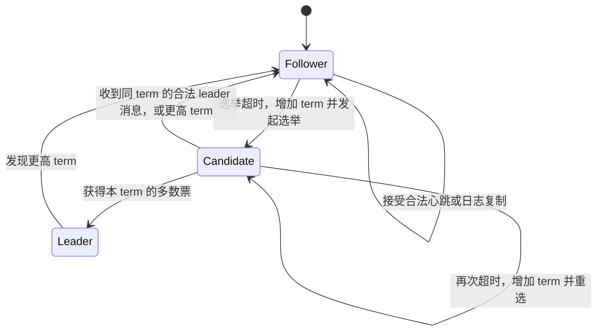

# LEC 11：Paxos 与 Raft

> 课程：SE3331 / CSE-fa26  
> 课件：[Paxos and Raft](../lectures/LEC-11-Paxos&Raft/paxos-and-raft.pdf)  
> 页码约定：「讲义页」指幻灯片右下角编号；PDF 共 235 页，包含目录及动画展开页，主体对应讲义页 1–67。本文合并重复展开页，按问题推进整理。课件封面标为 2025 Fall，本文归档于当前 CSE-fa26 仓库。  
> 「补充理解」「表述边界」「课件校正」用于区分课件内容与进一步说明。默认固定成员、非拜占庭故障：节点遵守协议，可以崩溃、重启或失联；消息可能延迟、丢失、重复或乱序；已完成的持久化写入在重启后仍可恢复。

## 1. 本讲主线：没有可靠的中心，怎样决定同一份历史？

对应讲义页 2、4–9、24–25、35–38，PDF 第 3、5–26、67–77、127–130 页。

[LEC 10](LEC-10-Multi-site-Atomicity-and-Replication.md) 用主备复制统一操作顺序，用 view server 决定谁是主节点，但留下了一个问题：**view server 自己故障时，谁来可靠地决定新的 view？**

把 view server 复制多份，又需要这些副本对同一项决定达成一致。这就是本讲的 **consensus（共识）**问题。

课件用 Paxos 岛议会作类比：议员可以随时离席，信使可能丢消息，但所有议员的账本对“第 37 号法令是什么”必须保持一致。

| 议会类比     | 计算机系统                     |
| ------------ | ------------------------------ |
| 议员         | Acceptor，保存协议状态的节点   |
| 法令内容     | 待决定的值 `V`                 |
| 账本         | 崩溃后仍保留的持久存储         |
| 多数议员     | Quorum，满足协议要求的一组节点 |
| 第 37 号法令 | 一个共识实例／一个日志位置     |

```text
单个决定：对同一个位置，最多选定一个值
          ↓
Single-decree Paxos：prepare + accept
          ↓
Multi-Paxos：每个日志位置一个实例，组成有序历史
          ↓
稳定 leader：减少争抢，合并 prepare，降低正常路径开销

Raft：直接从复制日志出发
          ↓
选举 leader → 复制日志 → 修复分叉
          ↓
投票时比较日志 + 提交时检查任期
          ↓
未来 leader 必须保留已经提交的历史
```

**本讲反复出现的原则：新一轮有权继续工作，不代表有权推翻以前已经确定的结果。**

### 1.1 与 2PC 的区别

| 问题         | 2PC                            | Paxos / Raft                                 |
| ------------ | ------------------------------ | -------------------------------------------- |
| 协调什么？   | 多个参与者对事务的提交或中止   | 多个副本对值或日志历史的选择                 |
| 关键条件     | 提交需要所有参与者承诺可以提交 | 依靠 quorum 及历史保留规则达成决定           |
| 原协调者失联 | PREPARED 参与者可能阻塞        | 在多数派可通信且能稳定推进时，可以换节点继续 |

Paxos 有两个阶段，不意味着它就是“两阶段提交”。两者的参与者状态、投票含义和恢复规则都不同；共识协议也不会替业务事务决定所有参与者是否具备提交条件。

## 2. 目标、故障假设与多数派

对应讲义页 7–9、22–23、44–45，PDF 第 11–26、65–66、141–142 页。

### 2.1 Safety 与 liveness 分开判断

| 性质                     | 需要保证什么？                                         | 不代表什么？                             |
| ------------------------ | ------------------------------------------------------ | ---------------------------------------- |
| Safety（安全性）         | 同一个实例不能选定两个不同值；已经确定的结果不能被推翻 | 每个节点此刻都已收到相同消息             |
| Liveness（活性／进展性） | 在适当运行条件下，提案最终能够完成                     | 任意网络延迟、任意竞争下都有固定完成期限 |

节点尚未得知结果，不等于协议违反一致性；所有节点一直等待，也不等于协议产生了冲突结果。

**表述边界：**讲义页 7 将可用性目标概括为“多数节点存活就能在一定时间内接受值”。完整理解还需要：多数节点之间能够通信，消息和处理最终足够及时，并且竞争不会无限阻止某个 proposer／leader 完成。多数节点虽然活着，但彼此被网络分区隔开，仍不能推进。

本讲不处理节点伪造消息、故意违背承诺或任意篡改日志的拜占庭故障。

### 2.2 多数派为什么有用？

设固定配置共有 `N` 个节点，普通多数派大小为：

```text
q = floor(N / 2) + 1
```

任意两个多数派 `Q1`、`Q2` 都满足：

```text
|Q1 ∩ Q2| ≥ |Q1| + |Q2| - N > 0
```

例如 5 个节点的任意两个 3 节点集合，至少重叠一个节点。这个交集节点可以把旧轮次的承诺、已接受值或日志信息带到新轮次。

| 总节点数 `N` | 多数派 `q` | 仍能凑齐多数派时，最多不可用节点数 |
| ------------ | ---------- | ---------------------------------- |
| 3            | 2          | 1                                  |
| 4            | 3          | 1                                  |
| 5            | 3          | 2                                  |
| 7            | 4          | 3                                  |

常见配置 `N = 2f + 1` 可以在 `f` 个节点不可用时仍保留多数派。**数量足够是必要条件，还需要剩余节点能通信并满足协议进展条件。**

多数派的计数包含 proposer／leader 自己，只要它也属于该配置并完成相应持久化。3 节点系统通常是 leader 自己加 1 个 follower，并非再等 2 个 follower。

### 2.3 Quorum 交集本身不是完整协议

如果交集节点可以任意改变决定，两个多数派仍可能先后接受不同结果。因此还需要规定：

- 节点必须持久化并遵守哪些承诺。
- 新提案怎样继承旧值或旧日志。
- 哪些请求必须拒绝。
- 何时可以向客户端确认成功。

Paxos 与 Raft 的核心都在于：**让交集节点保存的信息真正约束后续决定。**

## 3. Paxos 的角色、编号与持久状态

对应讲义页 10–12、18–21，PDF 第 27–37、61–64 页。

本节先讨论 **single-decree Paxos**：只为一个固定实例决定一个值。

### 3.1 三种角色不是三组专用机器

| 角色               | 职责                                              |
| ------------------ | ------------------------------------------------- |
| Proposer（提议者） | 发起提案，收集 promise，选择本轮允许提出的值      |
| Acceptor（接受者） | 记录承诺及已接受提案，决定是否接受消息            |
| Learner（学习者）  | 得知哪个值已经 chosen；在状态机应用中驱动后续执行 |

一台服务器可以同时承担三种角色。课件把当前发起提案的节点称为 leader，但 **single-decree Paxos 的安全性不要求任何时刻都只有一个 proposer**。

### 3.2 三个持久变量

| 课件记号 | 含义                                                    | 更新规则                    |
| -------- | ------------------------------------------------------- | --------------------------- |
| `Nh`     | 已承诺不再接受更小编号的门槛，可理解为 `promisedNumber` | 只增不减                    |
| `Na`     | 已接受提案中最大的编号，即 `acceptedNumber`             | 与 `Va` 配套保存            |
| `Va`     | 编号 `Na` 对应的已接受值，即 `acceptedValue`            | 接受合法新提案时更新        |
| `Mn`     | 本 proposer 当前尝试的提案编号                          | 本轮工作状态                |
| `V`      | 本 proposer 本轮要发送的值                              | 可能被 promise 中的旧值替换 |

在课件模型中，`Nh`、`Na`、`Va` 持久化；本轮 `Mn`、`V` 可以在崩溃后丢弃。有效状态满足 `Na ≤ Nh`，没有接受过提案时 `(Na, Va)` 为空。

例如：

```text
Nh = 8, Na = 5, Va = foo

我已答应拒绝编号小于 8 的请求；
但我实际接受过的最高提案仍是 (5, foo)。
```

**Promise 不等于 accept。** 提升 `Nh` 时，不会自动把 `Na` 提升，也不会自动接受新值。

### 3.3 Proposal number 必须全序且不重复

不同 proposer 不能都用裸整数 `1` 提出不同值，否则 acceptor 无法区分它们。常见编码是：

```text
proposalNumber = (counter, nodeId)

先比较 counter，相同再比较 nodeId。
例如：(7, S1) < (7, S3) < (8, S1)
```

本笔记的数值例子用 `1、2、3` 简写，默认已经满足全局唯一性。

同一实例、同一 proposal number 只能对应一个值。消息重试可以重复发送同一个提案，不能悄悄把它的值换掉。

**补充理解：**“本轮状态可丢弃”不表示重启后可以复用旧编号。编号分配还须防止跨重启重复，例如持久化已使用计数器；这是 [Paxos Made Simple §2.5](https://lamport.azurewebsites.net/pubs/paxos-simple.pdf) 明确要求的实现条件。

## 4. 为什么需要 prepare、编号和旧值继承？

对应讲义页 8–17，PDF 第 12–60 页。

课件按三次修正推导 Paxos。

### 4.1 只授予一次写权限，会阻塞恢复

假设多数派把唯一写权限授予 S1，之后永远不再授予其他节点。S1 写入前崩溃，就没人能够继续。

解决方向：每次请求带 proposal number，允许更大的编号取得新的 promise。这样，新 proposer 不需要等旧 proposer 恢复。

### 4.2 只认更大编号，又会覆盖已经 chosen 的值

一个不完整协议可能发生：

| 步骤 | 事件                                          |
| ---- | --------------------------------------------- |
| 1    | S1 以编号 1 提出 `V1`                         |
| 2    | S1、S2 都接受 `(1, V1)`，`V1` 已被多数派选定  |
| 3    | S3 以编号 2 获得 S2、S3 的 promise            |
| 4    | S3 随意提出 `V2`                              |
| 5    | S2、S3 接受 `(2, V2)`，另一个值也被多数派选定 |

两组多数派确实在 S2 相交，但若 S2 允许后续提案随意覆盖旧决定，交集就没有提供所需保护。

### 4.3 Prepare 必须既约束未来，也询问过去

Acceptor 回复 promise 时做两件事：

1. 承诺以后不再接受小于本轮编号的提案。
2. 返回自己最高的已接受提案 `(Na, Va)`。

Proposer 收到一个多数派的成功回复后：

```text
若所有回复都没有 accepted value：
    可以使用自己原本想提出的值。

若至少一条回复包含 accepted value：
    必须选择回复中 Na 最大的那条记录的 Va。
```

这里比较的是 **已接受编号 `Na`**，不是 promise 门槛 `Nh`，也不是“哪个值出现次数最多”。

更大的 proposal number 给予继续推进的机会；它不授予推翻已选定值的自由。

## 5. Single-decree Paxos：完整的两阶段流程

对应讲义页 11–12、18–22，PDF 第 32–37、61–65 页。

以下是按课件整理、补上持久化和消息归属的教学伪代码。`NONE` 表示“没有已接受提案”，与业务允许的值区分。

### 5.1 Phase 1：prepare / promise

Proposer 选择一个新的唯一编号 `n`，发送 `PREPARE(n)`。若被更高编号拒绝，应在新的尝试中选择更大的编号。

```text
Acceptor.onPrepare(n):
    if n < Nh:
        reply REJECT(currentPromise = Nh)
        return

    Nh = n
    persist(Nh)
    reply PROMISE(forProposal = n, accepted = (Na, Va))
```

这里沿用课件对 `n == Nh` 可重复返回 promise 的写法；前提是编号唯一、重试不改变同一提案的值。

Proposer 必须收集 **同一个实例、同一个编号 `n`、来自不同 acceptor** 的多数派回复，不能把旧轮次消息或重复消息凑成多数派。

### 5.2 Phase 2：accept / accepted

```text
Proposer.afterMajorityPromises(n, replies):
    accepted = replies 中所有非 NONE 的 (Na, Va)

    if accepted 为空:
        v = 本次客户端希望提出的值
    else:
        v = accepted 中 Na 最大的记录所对应的 Va

    send ACCEPT(n, v) to acceptors
```

```text
Acceptor.onAccept(n, v):
    if n < Nh:
        reply REJECT(currentPromise = Nh)
        return

    Nh = n
    Na = n
    Va = v
    persist(Nh, Na, Va)
    reply ACCEPTED(forProposal = n)
```

Acceptor 在接受阶段再次检查编号，因为从 promise 到 accept 之间，它可能已经答应了一个更高编号的 proposer。

**表述边界：** acceptor 不要求自己此前一定给这个 proposer 发过 promise。Proposer 必须先取得一个 prepare 多数派；acceptor 则按本地承诺门槛判断 accept 是否允许。两个阶段使用的多数派可以不同。

### 5.3 Chosen 与 learned 是不同事件

```text
一个提案 (n, v) 被多数派 acceptor 成功接受并持久化
    → v 已经 chosen（选定）。

Proposer 收到相应多数派 ACCEPTED
    → proposer 知道 v 已经 chosen。

Proposer 发出 DECIDE(n, v)，其他节点收到
    → 更多 learner 得知结果。
```

**决定点是多数派实际接受，不是多数派 promise，也不是最后一条确认回复抵达 proposer。**

若多数派已经接受，但回复全丢了，结果仍然 chosen；只是 proposer 不知道。之后的新轮次必须保留这个结果。

对单个 acceptor 而言，`accepted` 也不等于 `chosen`：它通常不知道是否已有足够多其他节点接受。

### 5.4 两条持久化顺序

```text
保存 promise 门槛 Nh           → 回复 PROMISE
保存已接受提案 Nh / Na / Va    → 回复 ACCEPTED
```

重启不能让节点忘记对外作出的承诺或已确认接受的值，否则后续 quorum 交集可能失效。

**课件校正：**讲义页 20 的 `if V != null` 应理解为“收到的 promise 中存在已接受值”，不能按 proposer 原本的客户端值是否为空来判断；`DECIDE` 也应携带本轮已经取得多数确认的值，不能随意读取另一个角色的可变 `Va`。

## 6. Paxos 的关键例子与安全性直觉

对应讲义页 13–17、21–22，PDF 第 38–60、64–65 页。

### 6.1 S1 已经写入 foo，S3 还能改成 bar 吗？

初始有 S1、S2、S3，所需多数派为 2：

| 时刻                   | S1              | S2                            | S3                      |
| ---------------------- | --------------- | ----------------------------- | ----------------------- |
| 编号 1 的 accept 完成  | 接受 `(1, foo)` | 接受 `(1, foo)`               | 无已接受值              |
| S1 崩溃                | 不可用          | 保存 `foo`                    | 想提出 `bar`            |
| S3 发 `PREPARE(2)`     | 不回复          | 返回 `(1, foo)`，并 promise 2 | 返回 NONE，并 promise 2 |
| S3 选择本轮值          | —               | —                             | 必须选择 `foo`          |
| S3 发 `ACCEPT(2, foo)` | —               | 接受 `(2, foo)`               | 接受 `(2, foo)`         |

最初多数派 `{S1, S2}` 与新 prepare 多数派 `{S2, S3}` 相交于 S2，旧值通过 S2 的回复进入新轮次。

### 6.2 为什么不是按出现次数投票？

**补充示例：** 5 节点系统中，某个 proposer 得到 3 条 promise：

| Acceptor | 返回的 `(Na, Va)` |
| -------- | ----------------- |
| A        | `(4, x)`          |
| B        | `(7, y)`          |
| C        | `(4, x)`          |

本轮必须选 `y`，因为最高 `Na` 是 7。不能因为 `x` 出现两次就选择 `x`。协议依赖提案编号建立的继承关系，而不是对业务值计票。

### 6.3 只有少数节点接受的值，一定被永久保留吗？

不一定。例如三节点中只有 A 接受 `(1, foo)`：

- 新 prepare 多数派若是 `{A, B}`，看到 `foo` 后必须按最高已接受编号规则继承它。
- 新 prepare 多数派若是 `{B, C}`，两者都无已接受值，可以提出 `bar`；它们的 promise 又会阻止旧编号 1 在 B、C 上补齐多数派。

所以：**一个值没 chosen，不意味着新 proposer 可以忽略自己实际收集到的 accepted 记录；但也不意味着所有后续轮次必然保留它。**

### 6.4 安全性来自三条规则共同作用

```text
多数派交集：新一轮必然碰到旧决定的某个见证者。
持久 promise：见证者不会再帮助更小编号形成新的冲突决定。
最高 Na 继承：更大编号继续携带必须保留的旧值。
```

若 `(n, v)` 已 chosen，则以后更大编号的合法提案必须保留 `v`。证明需要按提案编号归纳：交集节点可能已接受更高编号，但那些中间提案也必须沿用 `v`，于是最高已接受编号的值仍是 `v`。

因此，**不同编号的提案可以先后 chosen，但对同一个实例，它们的值必须相同。**

## 7. Paxos 的故障处理与活性

对应讲义页 22–23，PDF 第 65–66 页。

### 7.1 先看故障前已经持久化了什么

| 故障位置                            | 影响与恢复方向                                             |
| ----------------------------------- | ---------------------------------------------------------- |
| Acceptor 发出 promise 后崩溃        | 重启后恢复 `Nh`，继续拒绝低编号；其他节点可用更高编号推进  |
| 收到 accept，但尚未成功持久化就崩溃 | 不能把这次收到消息算作已经接受；恢复结果以完整持久状态为准 |
| 持久化 accepted 后、回复前崩溃      | 该接受事实仍存在；回复丢失不等于没有接受                   |
| Proposer 在 prepare 阶段崩溃        | 其他 proposer 可尝试更大编号，不必永久等待它               |
| Proposer 在只复制到少数节点时崩溃   | 新轮次根据自己收集的 promise 选择允许的值                  |
| Proposer 在多数派接受后、通知前崩溃 | 值已 chosen；新轮次必须保留并可重新传播结果                |
| 网络分区，只有一边包含多数派        | 多数派一侧在满足进展条件时可继续；少数派不能独立选定新值   |

### 7.2 两个 proposer 可以互相抢占而一直没有结果

```text
P1 获得编号 1 的多数 promise。
P2 在 P1 完成 accept 前，获得编号 2 的多数 promise。
P1 的 accept(1, ...) 被拒绝。

P1 改用编号 3，又在 P2 完成前取得多数 promise。
P2 的 accept(2, ...) 被拒绝。

继续交替，双方都没有完成。
```

这个执行可以一直安全，却不产生进展。稳定的 distinguished proposer、超时与随机退避有助于减少争抢；网络和调度仍需最终允许一次完整通信过程。[Paxos Made Simple §2.4](https://lamport.azurewebsites.net/pubs/paxos-simple.pdf) 给出了这一活锁例子及进展条件。

### 7.3 超时不是对旧提案的撤销

超时只表示没有及时收到足够回复。旧消息可能仍在网络中，甚至旧提案已经 chosen。

正确恢复方式是用更大编号重新运行协议，通过 promise 了解旧状态；不能宣布“超时，所以此前所有接受都作废”。

## 8. Multi-Paxos：从一个值到一串日志

对应讲义页 24–34，PDF 第 67–126 页。

### 8.1 Instance number 与 proposal number 是两条轴

Single-decree Paxos 一次只决定一个值。要复制状态机日志，就为每个日志位置运行一个实例：

```text
instance / slot：  0       1       2       3       4
chosen value：   add     cmp     xxx     zzz     yyy
```

| 编号                     | 回答什么问题？                 |
| ------------------------ | ------------------------------ |
| Instance / slot number   | 正在决定日志中的哪个位置？     |
| Proposal / ballot number | 为这个位置进行的是哪一轮竞争？ |

消息因此需要区分 `PREPARE(slot, ballot)`、`ACCEPT(slot, ballot, value)`。同一 ballot 可以用于多个 slot，但每个 slot 的 accepted value 必须分别保存。

View server 的例子是：`view 1` 由实例 1 决定，`view 2` 由实例 2 决定。后续 view 是新的日志位置，不是修改前一个实例已经 chosen 的值。

### 8.2 想写入的 slot 已经被占用怎么办？

课件中 S1 想把 `yyy` 放进 slot 3，但 S2、S3 已接受并选定 `zzz`：

```text
S1 对 slot 3 运行 prepare
    → 得知必须继承 zzz
    → 完成 slot 3 = zzz
    → 改为尝试 slot 4 = yyy
```

不能为了完成自己的请求而把 slot 3 改成 `yyy`。同样，完成了 slot 3 的共识，也不能把 `zzz` 的成功误报成客户端请求 `yyy` 已完成。

### 8.3 稳定 leader 提高效率

朴素方案每个 slot 都执行：

```text
Prepare + Promise：1 RTT
Accept + Accepted：1 RTT
合计：理想情况下约 2 RTT / entry
```

多个 proposer 还会争抢同一 slot，或用更高 ballot 相互打断。

稳定 leader 负责分配 slot，客户端把请求交给它；再把针对一段 slot 的 prepare 合并到一次通信中：

```text
建立领导权：Prepare(ballot = b, slots = k..∞)
                         ↓
后续正常路径：Accept(k, b, v1)
              Accept(k+1, b, v2)
              Accept(k+2, b, v3)
```

在该 ballot 仍有效的稳定阶段，每个新条目通常只需要一轮 accept 通信，约 **1 RTT / entry**。这里不计客户端往返、持久化耗时和重试。

**表述边界：**合并 prepare 仍需让 acceptor 保存相应范围的 promise，并返回已有 accepted 记录；新 leader 必须先处理这些旧值。它不能只获得“未来写权限”就忽略范围内已有的历史。更高 ballot 出现后，旧 leader 的 accept 仍会被拒绝。

### 8.4 多个 leader 不必破坏 Paxos 安全性，但可能拖慢系统

只要所有 proposer 都遵守编号、promise 和旧值继承规则，即使暂时有多个节点自认为 leader，也不能让同一 slot 选定不同值。

因此稳定 leader 是减少冲突、改善进展和性能的重要安排；它不是 single-decree Paxos 唯一的安全屏障。

### 8.5 日志空洞：后面的值 chosen，不等于可以先执行

不同实例可独立决定，可能出现：

```text
slot：   0      1      2      3
value： add    cmp    ?     yyy
```

复制状态机必须按顺序执行，不能跳过 slot 2 直接执行 slot 3。

恢复时需要补齐 slot 2：按该实例的 Paxos 规则取得已有值；若协议允许选择新值，可以提出 `no-op` 并通过共识选定。**不能在本地直接把未知位置填成 no-op，因为它可能已经在别处选定了真实命令。**

课件以 leader 管理和日志空洞说明：从单值共识到完整复制服务，还需要明确选举、恢复、排序和执行规则。Raft 从复制日志整体出发组织这些规则。

## 9. Raft：围绕复制日志拆解问题

对应讲义页 35–42，PDF 第 127–139 页。

Raft 直接维护一条复制日志，再让各状态机按顺序执行已提交命令：

```text
相同初始状态 + 相同已提交命令序列 + 确定性执行
    → 相同状态与结果
```

它把问题拆成三个部分：

1. **Leader election：**选择 leader，并在它失联后重新选举。
2. **Log replication：** leader 决定顺序，将日志复制给 follower，并修复分叉。
3. **Safety：**约束选举与提交，让修复过程无法破坏已提交历史。

### 9.1 三种状态

| 状态      | 主要职责                                     |
| --------- | -------------------------------------------- |
| Follower  | 响应候选人的投票请求与 leader 的日志复制请求 |
| Candidate | 发起选举，争取多数派投票                     |
| Leader    | 接受客户端命令、追加日志并向 follower 复制   |



这里的“follower 被动”指正常协议交互由 leader／candidate 发起；follower 仍会在选举超时后主动成为 candidate。

### 9.2 Term 是逻辑任期，不是统一的物理时间段

每个节点维护单调递增的 `currentTerm`。一次选举在新的 term 中启动；这个 term 可能产生一个 leader，也可能因为分票而没有 leader。

不同节点得知新 term 的时间不同。例如 S1 因网络分区仍停留在 term 2，其他节点已经进入 term 3。

Raft 保证 **同一个 term 至多选出一个 leader**。它不保证所有节点在任意时刻都对“当前 leader 是谁”有相同认知。

旧 leader 可以暂时继续自认为 leader，但不能因此绕过多数派和任期检查提交新命令。

### 9.3 Heartbeat 与 timeout

Leader 周期性发送 heartbeat，通常用不携带新条目的 `AppendEntries` 表示。Follower 长时间没有收到有效 leader 消息等选举活动，就发起选举。

超时是怀疑故障的依据，不是对方已崩溃的证明。课件中的 100–500 ms、`[T, 2T]` 都是教学示例，不是所有部署必须使用的协议常数。

## 10. Raft 选举：一任期一票，还要比较日志

对应讲义页 41–47、61，PDF 第 133–151、211 页。

### 10.1 发起选举的步骤

```text
1. 转为 candidate。
2. currentTerm += 1。
3. votedFor = 自己，并持久化 term 与投票记录。
4. 重置随机选举超时。
5. 向其他节点发送 RequestVote。
```

随后可能出现三种结果：

| 结果                                                      | 动作                                      |
| --------------------------------------------------------- | ----------------------------------------- |
| 获得本 term 多数派投票，包含自己                          | 成为 leader，发送心跳建立联系             |
| 收到同 term 合法 leader 的 AppendEntries，或发现更高 term | 转回 follower；更高 term 还要更新本地任期 |
| 选举超时，仍没有多数票                                    | 增加 term，重新发起选举                   |

选票必须按当前 term 统计，来自同一节点的重复回复只算一票。

### 10.2 为什么一个任期最多一个 leader？

每个节点在一个 term 中最多投给一个候选人，获胜者必须获得多数派。

假如同一 term 中 A、B 都获胜，它们的选票多数派必相交；交集节点就必须在同一 term 投给两个人，与规则矛盾。

“最多投一人”允许对同一 candidate 的重复请求返回相同肯定答复，但不允许改投其他人。

### 10.3 `currentTerm` 与 `votedFor` 都要持久化

课件的反例：

```text
term 2：S1 得到 {S1, S2, S3} 的票，当选。

S3 崩溃重启，忘记自己已经投过 S1。

仍在 term 2：S3 又投给 S5。
S5 得到 {S3, S4, S5} 的票，也当选。
```

结果是同一 term 两个 leader。多数派交集依旧存在，但交集节点忘记了投票，安全性就失效了。

所以任期和投票记录必须在肯定回复前持久化；进入更高 term 时，可以清空上一 term 的 `votedFor`，在新 term 重新投票。

### 10.4 随机超时改善活性

如果所有节点使用完全相同的超时并同步发起选举，可能反复分票。独立随机化超时能让某个候选人更早开始，在其他节点也超时前收齐多数票。

随机化降低持续冲突的概率，但不能让完全无法通信的多数派完成选举。

**课件校正：**讲义页 45 的“多个 candidate 同时开始就没人获胜”应理解为“可能分票”；多个 candidate 并存时，仍可能有一个获得多数票。

### 10.5 完整投票条件

课件先展示只检查 term 与 `votedFor` 的版本，讲义页 61 才补上日志条件。最终的 `RequestVote` 应携带：

```text
term, candidateId, lastLogIndex, lastLogTerm
```

Follower 只有在以下条件都成立时才投赞成票：

1. 候选人的 term 不过期；若更高，先更新本地 term、转为 follower，并清空旧任期投票。
2. 当前 term 尚未投票，或已经投给同一 candidate。
3. 候选人的日志至少与自己的日志一样新。

```text
candidateUpToDate =
    candidate.lastLogTerm > local.lastLogTerm
    OR
    (candidate.lastLogTerm == local.lastLogTerm
     AND candidate.lastLogIndex >= local.lastLogIndex)
```

**先比最后一条日志的 term，term 相同才比 index。** 这里不是比较候选人的 `currentTerm`；候选人提高竞选任期，不会自动让旧日志变新。

| 本地日志的 term 序列 | 候选人日志的 term 序列 | 候选人至少一样新吗？                   |
| -------------------- | ---------------------- | -------------------------------------- |
| `[1, 1, 2, 2]`       | `[1, 1, 2, 2, 2]`      | 是：最后 term 相同，候选人更长         |
| `[1, 1, 2, 2, 2]`    | `[1, 1, 2, 3]`         | 是：候选人最后 term 更高，即使长度更短 |
| `[1, 1, 2, 3]`       | `[1, 1, 2, 2, 2]`      | 否：长度更长不能弥补最后 term 更低     |

**表述边界：** Raft 不要求候选人是全系统日志最长的节点，也不先收集所有日志进行全局排名。每个投票者按自己的日志作判断，候选人争取一个合法多数派。

## 11. Raft 日志与正常写入流程

对应讲义页 48–50，PDF 第 152–162 页。

### 11.1 一条日志包含什么？

```text
entry = (index, term, command)

index：日志中的位置
term：该条目最初由 leader 创建时所属的任期
command：状态机要执行的命令
```

Leader 接管旧条目并重新复制时，**不会把旧条目的 term 改成自己的 currentTerm**。

例如 currentTerm 为 4 的 leader 可以保存：

```text
index：   1    2    3    4
term：    1    1    2    4
```

### 11.2 四个容易混淆的阶段

| 阶段       | 含义                                           |
| ---------- | ---------------------------------------------- |
| Appended   | 条目已经追加到某个节点的日志                   |
| Replicated | 条目已经复制到其他节点，具体数量仍需说明       |
| Committed  | 按完整协议已经不可被后续合法历史推翻，可以执行 |
| Applied    | 该节点已经把已提交命令应用到状态机             |

日志已落盘不等于已提交；已提交也不意味着所有 follower 此刻都已执行。

讲义页 48 用“最终在所有服务器上保存相同值”描述提交的效果。它不是要求现在等齐所有服务器才提交，也不是保证永久离线的服务器一定会重新上线。

### 11.3 正常路径：当前任期的一条命令

```text
Client             Leader                  Follower A        Follower B
  |                   |                         |                 |
  |--- command ------>|                         |                 |
  |                   | append + persist        |                 |
  |                   |--- AppendEntries ------>|                 |
  |                   |--- AppendEntries ------------------------>|
  |                   |                         | persist entry   |
  |                   |<------ success ---------|                 |
  |                   |                         |                 |
  |                   | self + A = 2/3          |                 |
  |                   | commit, then apply      |                 |
  |<----- result -----|                         |                 |
  |                   |--- leaderCommit ------->|                 |
```

只要满足本讲后面说明的选举限制和提交条件，leader 不必等最慢的 follower；但 leader 自己的保存也必须可靠，follower 应在相应日志持久化后返回成功。

之后 leader 通过 `AppendEntries` 传播 `leaderCommit`，follower 再按日志顺序执行自己已经获知提交的前缀。

### 11.4 用几个位置变量区分“保存了”和“确认了”

**补充理解：**下面补齐 [Raft 原论文 Figure 2](https://raft.github.io/raft.pdf) 的状态命名，便于理解课件正常路径与提交规则。

| 变量            | 含义                                          |
| --------------- | --------------------------------------------- |
| `commitIndex`   | 本节点已知提交的最大日志位置                  |
| `lastApplied`   | 本节点已执行到的最大日志位置                  |
| `nextIndex[f]`  | Leader 下次准备向 follower `f` 发送的起始位置 |
| `matchIndex[f]` | Leader 已确认 follower `f` 与自己匹配到的位置 |

`nextIndex` 是复制尝试的位置，不能当作已成功复制的证据；提交判断使用确认过的 `matchIndex`。在未引入快照的模型中，`lastApplied ≤ commitIndex ≤ lastLogIndex`。

### 11.5 重试 RPC 不等于重复执行命令

课件说 `AppendEntries` 是 at-least-once：leader 可以因超时重复发送。

Follower 应根据 index、term 和日志匹配规则处理重发，而不是每收到一个 RPC 就把命令再追加、再执行一次。业务执行由“按顺序应用已提交条目”驱动。

## 12. 分叉日志如何修复？

对应讲义页 51–56，PDF 第 163–194 页。

### 12.1 旧 leader 可能继续追加未提交条目

三节点中，S1 是 term 1 的 leader。S1 被分区隔离，S2、S3 在 term 2 选出新 leader：

```text
index：  1       2        3        4
S1：   add@1   cmp@1    xxx@1
S2：   add@1   cmp@1    shi@2
S3：   add@1   cmp@1    shi@2    ret@2
```

S1 可能仍收到客户端请求并把 `xxx` 写入本地，但没有多数派支持，不能据此确认提交。S1 恢复连接后，未提交的 `xxx@1` 可以被替换。

这不违反安全性：**Raft 允许未提交后缀暂时不同，要求已提交历史不能冲突。**

### 12.2 Log Matching Property

Raft 保持两个性质：

1. 两份日志若在同一 index 上具有相同 term，该位置的 command 也相同。
2. 此时它们在该位置之前的整个前缀也相同。

不能把它缩写成“同 index 就相同”或“同 term 的所有条目都相同”。

第一条依靠每个 term 至多一个 leader，以及 leader 不在同一位置创建两条不同日志；第二条依靠复制时检查前驱匹配，并逐步维持前缀关系。

### 12.3 `prevLogIndex` 与 `prevLogTerm`

Leader 发送新条目时，同时带上前一条日志的位置和任期：

```text
prevLogIndex = firstNewIndex - 1
prevLogTerm  = leader.log[prevLogIndex].term
```

Follower 只有在本地存在匹配的前驱时，才能接上这些条目；若该位置不存在，或 term 不同，则拒绝。

```text
Leader：   [1, 1, 1, 2, 3]
Follower： [1, 1, 1, 1]

尝试发送 index 5，要求 prev = (index 4, term 2)
Follower 的 index 4 是 term 1 → 拒绝。

退回发送 index 4，要求 prev = (index 3, term 1)
前驱匹配 → 用 leader 的 index 4 替换冲突后缀，再继续复制。
```

方括号中的数字都是条目的 term，不是业务值。

### 12.4 `nextIndex` 回退与冲突后缀替换

Leader 为每个 follower 分别维护 `nextIndex`。基础做法是：

```text
前驱不匹配而拒绝
    → 减小该 follower 的 nextIndex
    → 重新发送带有更早前驱的 AppendEntries
    → 找到共同前缀
    → 删除 follower 的冲突条目及其后缀
    → 追加 leader 提供的条目
```

**不是所有拒绝都回退重试。** 如果回复携带更高 term，当前 leader 必须先退位。

Leader 在任职期间只追加自己的日志；它通过修改 follower 的冲突后缀恢复一致性。一个节点后来转为 follower 时，自己的未提交后缀也可能被新 leader 修复。

### 12.5 课件简化伪代码需要怎样阅读？

讲义页 56 省略了若干细节，完整 `AppendEntries` 还包含 `leaderId`、`leaderCommit`，并遵守以下条件：

- 过期 term 必须立即拒绝，不能继续进入后面的成功分支。
- 遇到更高 term，先更新任期并转为 follower。
- 只在新旧条目于相同 index 的 term 冲突时，删除该冲突点及后缀。
- 已匹配条目不重复追加；空心跳不能无条件清空后缀。
- 更新日志须在成功回复前持久化；随后按获知的提交边界顺序执行。

这些补全对应 [Raft 原论文 Figure 2](https://raft.github.io/raft.pdf)。不能把课件中用于展示主线的几行伪代码直接当成完整实现。

## 13. 为什么选举必须比较日志？

对应讲义页 57–62，PDF 第 195–218 页。

### 13.1 只保证“一任期一个 leader”仍然不够

课件先构造一个尚未加入日志投票限制的协议：

```text
S1 是 term 2 的 leader。
index 4 的 term-2 条目复制到了 S1、S2、S3，共 3/5。
S1 崩溃。

只有 [1, 1] 的 S5 在 term 3 当选。
S5 在 index 3 追加新命令，并用自己的日志覆盖其他节点的后缀。
原来的 index 4 消失。
```

若此前已经把 index 4 执行并回复客户端，就违反了安全性。

问题不在“多数派不相交”，而在 **S2、S3 虽然保存旧条目，却仍把票投给了不包含该历史的候选人**。

### 13.2 日志新旧检查让交集节点发挥作用

加入第 10.5 节的规则后：

- 只有 `[1, 1]` 的 S5，比保存 `[1, 1, 2, 2]` 的节点落后。
- S2、S3 会拒绝 S5。
- 没有最新前缀的候选人无法绕过保存该前缀的多数派。

在完整规则下，**leader 当前 term 的条目一旦保存到多数派，就可以确定提交；所有后续 leader 必须包含它。**

### 13.3 Leader Completeness

本讲最终需要建立的性质是：

> 某条日志一旦提交，任何更高任期的 leader 都必须包含这条日志。

这让 follower 后缀覆盖成为安全操作：合法新 leader 自己就保留了所有已提交历史，它所修复的是与这些历史不兼容的未提交后缀。

但要建立完整性质，还差一个条件：**旧任期条目的提交方式不能与当前任期条目完全相同。**

## 14. 关键反例：旧条目在多数派上，为什么仍可能被覆盖？

对应讲义页 63–64，PDF 第 219–232 页。

以下沿用课件五节点例子。列表中的数字表示每个日志位置的 term，前两个 term-1 条目为共同前缀。

### 14.1 Term 2：条目只到达少数派

S1 在 index 3 创建 term-2 条目，只复制给 S2：

```text
S1：[1, 1, 2]    leader t2
S2：[1, 1, 2]
S3：[1, 1]
S4：[1, 1]
S5：[1, 1]
```

只有 2/5，尚未提交。随后 S1 所在一侧失联。

### 14.2 Term 3：S5 创建另一条未提交分支

S5 可以从 S3、S4、S5 取得多数票。它在本地追加 term-3 条目，但未复制到多数派：

```text
S1：[1, 1, 2]
S2：[1, 1, 2]
S3：[1, 1]
S4：[1, 1]
S5：[1, 1, 3, 3, 3]    leader t3
```

此时 term-2 和 term-3 的冲突分支都尚未提交。

### 14.3 Term 4：S1 回来，把旧条目补到多数派

S5 随后失联；S1 可以获得 S1、S2、S3 的票，成为 term-4 leader。S1 创建一个本任期的新条目，但暂时只在自己本地；它先把旧的 index 3 补给 S3：

```text
              index 1  2  3  4
S1：               [1, 1, 2, 4]    leader t4
S2：               [1, 1, 2]
S3：               [1, 1, 2]
S4：               [1, 1]
S5：               [1, 1, 3, 3, 3]
```

现在 index 3 的 term-2 条目存在于 S1、S2、S3，即 3/5。但是：

```text
log[3].term = 2
currentTerm = 4
```

它是旧任期条目，不能仅凭这个复制数量直接把它判为提交。

### 14.4 Term 5：S5 仍能合法当选并覆盖

如果 S1 再次崩溃，S5 发起 term-5 选举：

| 比较对象 | 最后一条日志的 `(term, index)` |
| -------- | ------------------------------ |
| S2、S3   | `(2, 3)`                       |
| S5       | `(3, 5)`                       |

S5 的日志被判为更新，因此 S2、S3 可以投给它。S5 当选后，把自己的 term-3 分支复制过去，覆盖 index 3 的 term-2 条目。

**整个过程可以遵守日志新旧投票规则，但此前补到多数派的旧条目仍被覆盖。**

根本原因是：保存旧条目的交集节点，最后日志 term 仍为 2，没有足够依据拒绝带着 term-3 日志的 S5。S5 发起选举时 `currentTerm = 5`，但它已有日志的最后 term 仍为 3；这两个数字要分开。

### 14.5 如果 S1 把 term-4 新条目也复制到多数派

改为在 S1 再次故障前完成：

```text
S1：[1, 1, 2, 4]
S2：[1, 1, 2, 4]
S3：[1, 1, 2, 4]
S4：[1, 1]
S5：[1, 1, 3, 3, 3]
```

此时 index 4 是当前任期条目，且已到多数派，可以提交。由日志前缀关系，index 3 也随之提交。

S5 的最后日志 term 为 3，落后于这三个节点的 4，无法取得多数票来覆盖这条历史。

## 15. Raft 的完整提交规则

对应讲义页 59、62–65，PDF 第 204、212–233 页。

### 15.1 当前任期直接提交，旧任期间接提交

| 条目情况                         | Leader 能否仅按复制到多数派判定提交？  |
| -------------------------------- | -------------------------------------- |
| 该条目由当前 term 创建           | 可以，前提是完整选举与复制规则成立     |
| 该条目来自更早 term              | 不可以直接用同一规则推断               |
| 某个后续、当前 term 的条目已提交 | 其前面的旧条目作为同一日志前缀一起提交 |

注意第三行是 **日志顺序中的后续条目**。不是任意地方出现一个新任期值，就能替旧条目提供提交依据。

### 15.2 常见的提交条件写法

补充 `matchIndex` 记号后，leader 可以寻找满足以下条件的最大位置 `k`：

```text
k > commitIndex
多数节点已经保存了与 leader 匹配到 k 的日志
log[k].term == currentTerm
```

用确认位置表示：

```text
count({s : matchIndex[s] >= k}) >= floor(N / 2) + 1
AND log[k].term == currentTerm

→ commitIndex = k
```

其中计数包含 leader 自己已经可靠保存的日志。推进到 `k` 后，整个前缀都可按序执行。这是 [Raft 原论文 Figure 2 与 §5.4.2](https://raft.github.io/raft.pdf) 的常用表达。

### 15.3 新 leader 为什么常追加 no-op？

**补充理解：**新 leader 可能保存了一批旧条目，却不知道其中哪些已经提交。它可以在当前 term 追加一条 `no-op`，把它复制到多数派并提交，从而确定前面的旧日志也已经提交。

No-op 不改变业务状态，但它必须是一条经过正常复制和提交流程的日志；不能只在本地插入一个标记就跳过协议。

### 15.4 两类规则共同保护历史

```text
选举规则：限制谁能成为下一任 leader。
提交规则：限制当前 leader 何时可以承诺结果不可撤销。

两者共同成立
    → 已提交条目存在于所有未来 leader 的日志中。
```

一个新 leader 可能不知道某条旧日志已经提交，但它必须包含该日志。**是否保存结果**与**是否已经知道结果提交**是两件事，和 Paxos 的 chosen／learned 区别相呼应。

## 16. Paxos 与 Raft 放在一起理解

对应讲义页 25、29–38、65–66。

| 比较项           | Paxos / Multi-Paxos                                                 | Raft                                               |
| ---------------- | ------------------------------------------------------------------- | -------------------------------------------------- |
| 起点             | 先解决单个值，再组合成日志                                          | 直接维护复制日志                                   |
| 轮次标识         | Proposal / ballot number                                            | Term                                               |
| 正常协调者       | Multi-Paxos 通常使用稳定 proposer                                   | Leader 负责正常日志追加与复制                      |
| 如何继承旧历史？ | Prepare 收集 accepted 状态，每个 slot 选择最高 accepted ballot 的值 | 投票比较日志，限制新 leader 必须包含已提交前缀     |
| 竞争控制         | 持久 promise 拒绝低 ballot                                          | 任期检查与每 term 一票                             |
| 稳定路径         | 合并 prepare 后，通常一轮 accept 往返                               | 通常一轮 AppendEntries 往返                        |
| 日志结构         | 不同实例可独立决定，需处理空洞及执行顺序                            | 用前驱匹配维持连续前缀，修复冲突后缀               |
| 决定／提交       | 同一提案被多数派接受即 chosen                                       | 当前 term 条目按多数派提交，旧条目随前缀间接提交   |
| 多 leader 认知   | 多 proposer 仍可安全，但可能相互抢占                                | 不同 term 的新旧 leader 可暂时并存于不同节点认知中 |
| 不能缺少的状态   | Promise 与 accepted 记录                                            | Term、投票与日志                                   |

Paxos 的 ballot 和 Raft 的 term 都用于排列轮次，但不能机械地把两者的变量或提交规则逐一替换。特别是 **Raft 重新复制旧条目时保留原 term**，而 Paxos 可以用新 ballot 再次提出必须继承的同一个值。

### 16.1 学完协议主线，还需知道的服务边界

以下为补充理解，本讲未展开实现：

- **客户端重试：**同一请求可能进入不同日志位置，业务层还需请求标识与去重，不能仅凭共识就宣称一次请求只执行一次。
- **读取：**旧 leader 可能与多数派失联，直接读它的本地状态不自动保证线性一致性；读路径也需要确认权限与提交进度。
- **成员变更：**本讲 quorum 推导使用固定成员集合，不能任意替换配置后继续套用旧多数派交集。
- **快照与恢复：**日志截断需要保存足够的状态与恢复元数据，不能直接删掉仍承担协议证明作用的记录。

因此，共识模块提供有序、不可推翻的已提交历史；完整服务还要把历史正确地连接到客户端请求、状态机执行和恢复过程。

## 17. 复习时抓住的十二条规则

1. **一个实例决定一个值。** 想决定后续命令，要使用新的日志位置。
2. **多数派必须来自同一固定配置。** 计数包含自己，但不能重复统计同一节点。
3. **Paxos 的 promise 不等于 accepted。** `Nh` 与 `Na` 可以不同。
4. **Paxos 选最高 `Na` 对应的值。** 不按值出现的次数投票。
5. **Paxos 的 chosen 是多数派实际接受。** 回复丢失不撤销决定。
6. **Proposal number 不能跨重启复用为新提案。** 同一实例、同一编号不能承载两个值。
7. **Raft 每 term 一票，投票必须持久化。** 一 term 至多一个 leader，不等于所有节点同步知道新 leader。
8. **Raft 比日志，先 term 后 index。** 不比较任意“最大序号”，也不只看长度。
9. **Raft 的旧日志条目保留原 term。** RPC 的 term 与每条日志的 term 是不同字段。
10. **前驱匹配才能接日志。** 只删除真正冲突的未提交后缀。
11. **当前 term 条目才能按多数派直接推进提交。** 旧 term 条目通过其后的当前 term 条目间接提交。
12. **安全性与进展性分开分析。** 超时、分票和分区可以让系统停止推进，但不能允许它撤回已承诺历史。

### 17.1 Paxos 时序题的分析顺序

```text
① 确认正在讨论哪个 instance，不能把不同 slot 的票混在一起。
② 列出每个 acceptor 的持久状态 (Nh, Na, Va)。
③ 每条 prepare / accept 先比较编号，再更新状态。
④ 收齐本轮多数 promise 后，选择最大 Na 对应的值。
⑤ 找同一个 (proposalNumber, value) 被多数派接受的时刻。
⑥ 分别标记：已 chosen、proposer 已知、learner 已知。
⑦ 崩溃只丢失允许丢失的内存状态；迟到消息仍按编号处理。
```

### 17.2 Raft 时序题的分析顺序

```text
① 列出每个节点的 currentTerm、votedFor 和日志 (index, term)。
② 检查投票是否同 term，是否重复投票，候选人日志是否足够新。
③ 收到更高 term 时，先更新任期并退回 follower。
④ 复制时检查 prevLogIndex / prevLogTerm，再确定冲突后缀。
⑤ 数实际确认的副本，包括 leader；不能把发送成功当作保存成功。
⑥ 检查目标条目的 term 是否等于当前 leader 的 term。
⑦ 若是旧 term，寻找其后已到多数派的当前 term 条目。
⑧ 最后才推进 commitIndex，按序 apply，并判断何时可回复客户端。
```

## 18. 复习自测

1. **5 节点系统中，2 个节点不可用还能推进吗？**  
   数量上仍有 3 节点多数派；还需它们能通信，且协议最终获得稳定推进条件。

2. **Paxos 收到多数 promise 后，值是否已经 chosen？**  
   没有。还需要同一个提案被多数派成功接受。

3. **Paxos 的值已被多数派持久化，但所有 ACCEPTED 回复都丢了，会失去决定吗？**  
   不会。值已经 chosen，只是 proposer 尚未得知。

4. **`Nh=10, Na=7, Va=x` 表示节点接受了编号 10 的 x 吗？**  
   不是。它承诺拒绝小于 10 的请求，实际最高已接受提案仍是 `(7, x)`。

5. **Promise 中有 `(4, x)、(7, y)、(4, x)`，应该提出哪个值？**  
   `y`，因为应选择最大 `Na` 对应的值。

6. **Acceptor 给编号 10 发过 promise，随后又给编号 11 发 promise，还能接受编号 10 吗？**  
   不能。接受阶段要再次检查当前 `Nh`。

7. **一个 acceptor 从未见过本轮 prepare，能接受本轮 accept 吗？**  
   若没有承诺更高编号，可以；但 proposer 必须已从一个合法多数派完成 prepare。

8. **只有一个 acceptor 接受的值，后续一定保留吗？**  
   不一定。后续 proposer 必须按自己收集到的多数 promise 选值；若该值从未 chosen，另一多数派可能完全没见过它。

9. **两个 proposer 不断抬高编号，违反安全性吗？**  
   不一定；它们可能始终遵守规则，却互相抢占导致没有进展。

10. **Multi-Paxos 的 slot 3 已经 chosen 为 zzz，客户端想写 yyy 怎么办？**  
    保留 slot 3，另找后续 slot 为 yyy 达成共识。

11. **Slot 4 已 chosen，但 slot 3 未知，可以执行 slot 4 吗？**  
    不可以。状态机要按序执行，须先通过协议补齐前面的空洞。

12. **合并 prepare 为什么降低正常路径 RTT？**  
    同一有效 ballot 已覆盖后续 slot，新条目通常只需执行 accept 阶段；接管时仍须恢复旧状态。

13. **Raft 一个 term 可以没有 leader 吗？**  
    可以，选举可能分票并在超时后进入下一 term。

14. **旧 term 的 leader 和新 term 的 leader 能同时自认为 leader 吗？**  
    可以暂时如此。任期和多数派规则限制旧 leader 继续提交；旧 leader 发现更高 term 后退位。

15. **为什么 `votedFor` 不能只放内存？**  
    重启后若忘记投票，就可能在同一 term 再投给另一个人，让两个候选人分别获得多数票。

16. **候选人提高 `currentTerm`，就能让自己的日志变得更新吗？**  
    不能。投票比较的是最后日志条目的 term 与 index。

17. **`[1,1,2,2,2]` 与 `[1,1,2,3]`，哪份日志更新？**  
    后者。最后 term 为 3，比长度优先级更高。

18. **两份日志同一 index 的 term 相同，能推出什么？**  
    在 Raft 不变量成立时，该条目命令相同，而且此前整个前缀相同。

19. **Follower 为什么不能直接把 leader 发来的新条目接到末尾？**  
    本地前缀可能与 leader 分叉，必须先验证 `prevLogIndex` 与 `prevLogTerm`。

20. **空心跳到来时，可以删除 follower 的所有额外日志吗？**  
    不可以。不能把没有携带新条目误解为发生了冲突；删除须从实际冲突位置开始。

21. **Leader 收到 AppendEntries 拒绝，是否总是递减 nextIndex？**  
    不是。若对方报告更高 term，应先退位；前驱不匹配才是回退找共同前缀的情形。

22. **3 节点系统一次写入要等两个 follower 都成功吗？**  
    不需要。Leader 自己可靠保存，加一个 follower 的保存，已构成 2/3；仍需满足任期与提交规则。

23. **Term-4 leader 把 term-2 条目复制到 3/5，可以直接判定提交吗？**  
    不能仅凭数量判定。还需通过后续当前 term 条目的提交，确认此前日志前缀。

24. **Term-4 的 index 8 已提交，index 7 属于 term 2，是否也提交？**  
    是。它位于已提交条目的日志前缀中。

25. **未提交条目能被覆盖，已提交条目也能吗？**  
    不能。完整选举和提交规则保证未来 leader 保留已提交条目。

26. **所有 follower 尚未 apply，leader 可以回复客户端吗？**  
    不必等所有 follower；应先满足提交条件，并由提供结果的 leader 按序执行到该请求。

27. **重发 AppendEntries 与客户端重试是同一层面的去重吗？**  
    不是。前者用日志位置与匹配规则处理；后者仍可能产生不同位置的重复业务请求，需要额外请求身份与去重状态。

28. **Paxos 和 Raft 都使用多数派，是否意味着它们的提交判断相同？**  
    不是。Paxos 判断同一提案是否被多数接受；Raft 还区分日志条目的创建任期与当前 leader 任期。

## 19. 课件定位索引

| 内容                                  | 讲义页 | PDF 页  |
| ------------------------------------- | ------ | ------- |
| 课程路线、议会类比、设计目标          | 2–7    | 3–11    |
| 写权限、递增编号、Paxos 角色          | 8–10   | 12–31   |
| Prepare 与 accept 的初步流程          | 11–12  | 32–37   |
| 并发写入反例与旧值继承                | 13–17  | 38–60   |
| Paxos 状态、伪代码、编号唯一性        | 18–21  | 61–64   |
| Chosen、故障与活性问题                | 22–23  | 65–66   |
| View server、Multi-Paxos 与 slot 冲突 | 24–28  | 67–107  |
| 稳定 leader、prepare 合并             | 29–32  | 108–124 |
| 实现问题与日志空洞                    | 33–34  | 125–126 |
| Raft 思路、复制状态机、角色状态       | 35–40  | 127–132 |
| Term、心跳、选举与持久投票            | 41–47  | 133–151 |
| 日志条目与正常复制路径                | 48–50  | 152–162 |
| 日志分叉、前驱匹配、nextIndex         | 51–55  | 163–193 |
| AppendEntries 简化伪代码              | 56     | 194     |
| 缺少选举限制时的覆盖反例              | 57–60  | 195–210 |
| 日志新旧比较、当前 term 条目          | 61–62  | 211–218 |
| 旧 term 多数派反例与完整提交规则      | 63–65  | 219–233 |
| 总结与参考文献                        | 66–67  | 234–235 |

课件外的实现细节核对使用作者原文：[Paxos Made Simple](https://lamport.azurewebsites.net/pubs/paxos-simple.pdf)（§2.4–2.5）与 [In Search of an Understandable Consensus Algorithm](https://raft.github.io/raft.pdf)（Figure 2、§5.4、§8）。笔记主线及例子仍以本讲课件为准。
