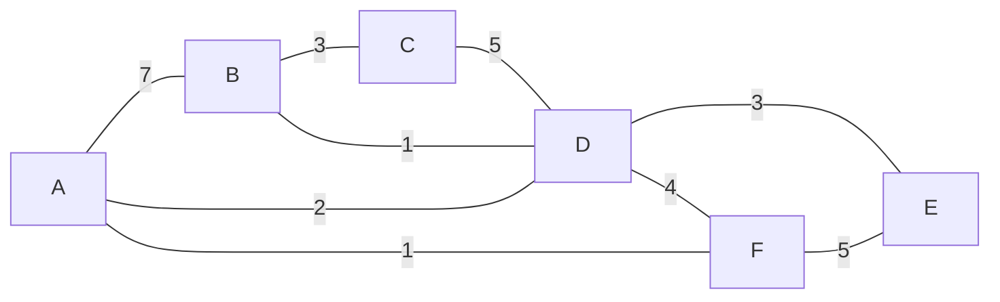

# LEC 15：网络层、IP 路由与转发（Network Layer & IP）

> 课程：SE3331 / CSE-fa26  
> 课件：[Network Layer — All about routing](../lectures/LEC-15-network-IP/CSE-15-network-ip.pptx)  
> 页码约定：本文的「课件页」指 PPT 中的幻灯片顺序，共 150 页，包含动画展开页；其中第 140–150 页为隐藏的 BGP 案例，本文仍予以整理，并明确标注。  
> 本文合并重复展开页，按主题整理。「补充理解」「补充推导」「课件校正」用于区分课件内容与进一步说明。路由算法采用课件的非负链路代价模型；实际报文处理以 IPv4 over Ethernet 为主，伪代码省略部分工程细节。

## 1. 本讲主线：怎样让一跳一跳的转发到达目的地？

对应课件页 2–12。

[LEC 14](LEC-14-network-link.md) 讨论了相邻节点怎样传输比特和帧。本讲进一步解决：**目的主机不在当前链路上时，怎样选出下一跳，并让各台路由器的选择共同形成可用路径。**

```text
应用交给网络一个目的 IP 地址
    ↓
控制平面：发现邻居 → 交换路由信息 → 选择路径 → 形成转发表
    ↓
数据平面：收到 IP 包 → 查目的地址 → 选下一跳与出口
    ↓
若出口是 Ethernet：解析下一跳 MAC → 封装成帧 → 发送
    ↓
下一台路由器重复处理，直到目的主机接收
```

### 1.1 IP 提供 best-effort 服务

IP 尽力传递数据包，但不保证每个包都到达，也不承诺按发送顺序、无重复地交付。无法转发、队列溢出或 TTL 耗尽等情况都可能导致丢包。

课件对比了在较高层保存完整消息、使用持久化缓冲并追踪消息的 guaranteed-delivery 模型。其可靠性仍依赖故障假设和实现，不能理解成绝对不会丢失。

**课件校正：**页 5 把 guaranteed-delivery 与 store-and-forward 并列。通常所说的「存储转发」只是先接收／缓存再发送；普通分组路由器同样可以存储转发，单凭这一方式不能保证交付。

页 3 复习的奇偶校验也只是差错检测：该编码的最小 Hamming distance 为 2，可以检测任意单比特错误。**帧内容通过校验，与跨网络可靠送达，是不同问题。**

### 1.2 路由、转发与两个平面

| 概念                    | 要回答的问题                 | 主要工作                             |
| ----------------------- | ---------------------------- | ------------------------------------ |
| Routing，路由           | 去往目的地应采用哪条路径？   | 交换拓扑／可达性信息，计算和更新路由 |
| Forwarding，转发        | 这个包现在从哪个接口交给谁？ | 按目的地址查表，处理头部并发送       |
| Control plane，控制平面 | 如何产生转发规则？           | 路由协议、路由选择与规则管理         |
| Data plane，数据平面    | 如何高效执行规则？           | 逐包查表、排队、修改头部、收发       |

路由算法不需要为每个数据包重新运行。拓扑或策略变化时，控制平面更新规则；数据平面持续使用当前规则。

静态路由由配置指定；自适应路由交换信息，响应链路变化与故障。课件也提到根据拥塞调整路径，但具体使用哪些指标取决于协议，不能假定所有路由都按实时拥塞变化。

### 1.3 网络地址与链路地址各自标识什么？

网络层使用源、目的网络地址标识通信的网络接入点。实际主机或路由器可以有多个接口、多个 IP 地址。

在普通逐跳转发中：

- **目的 IP** 用于确定包最终要到达的网络层目的地。
- **下一跳 IP／输出接口** 来自本地路由查询。
- **目的 MAC** 标识当前 Ethernet 链路上的下一跳。

因此，发往远端服务器的 IP 包，第一跳 Ethernet 帧的目的 MAC 通常是本地网关的 MAC。

## 2. 分布式路由的共同框架

对应课件页 11–13。

### 2.1 把网络抽象成带权图

节点表示参与路由的设备，边表示链路，边权表示代价。代价可以是管理配置的权重，也可以由某些链路属性导出。

本讲最短路径部分的目标是：对每个节点 X 和目的地 d，得到最小总代价及相应下一跳。

$$
D_X(d)=\min_{P:X\leadsto d}\sum_{(u,v)\in P}c(u,v)
$$

这里「最短」指所选代价之和最小，不一定是跳数最少、地理距离最短或实际时延最低。后面的 BGP 还会引入优先于路径长度的策略。

### 2.2 三个基本步骤

1. **发现邻居：**通过 HELLO 一类机制了解直接相连的节点及链路状态。
2. **传播信息：**使用 advertisement，让节点了解直接邻居之外的可达性。
3. **整合信息：**计算或更新路由，生成可供转发使用的下一跳。

HELLO 是课件中的通用概念，不要求所有协议都发送同名消息。BGP 使用会话与 KEEPALIVE 等机制维护邻接关系。

| 方法                      | 通告包含什么？                 | 通告给谁？                     | 如何整合？               |
| ------------------------- | ------------------------------ | ------------------------------ | ------------------------ |
| Link-state，链路状态      | 自己与直接邻居之间的链路及代价 | 通过 flooding 传到域内其他节点 | 建立拓扑，运行 Dijkstra  |
| Distance-vector，距离向量 | 自己到各目的地的当前代价       | 直接邻居                       | Bellman–Ford 式更新      |
| Path-vector，路径向量     | 到目的地的路径信息             | 协议邻居                       | 检查路径环路，按规则选路 |

## 3. Link-state：传播拓扑，再运行 Dijkstra

对应课件页 14–53。

### 3.1 本讲反复使用的六节点网络

课件图中各条链路均按双向、相同代价处理：



边集合也可写成：

```text
AB=7, AD=2, AF=1, BC=3, BD=1, CD=5, DE=3, DF=4, EF=5
```

A 的链路状态通告是：

```text
A: [(B, 7), (D, 2), (F, 1)]
```

这描述 A 的**直接链路**。即使 A 后来找到经 D 到 B、代价为 3 的路径，A–B 这条直接链路的代价仍是 7，不能因此把链路状态通告中的 `(B, 7)` 改成 `(B, 3)`。

### 3.2 Flooding：让其他节点也知道这些链路

节点收到一个新的通告后，将它传播给其他邻居，最终让连通区域中的节点获得足够的拓扑信息。

课件强调两个减少重复传播的方法：

- 记录已经转发过的通告，避免同一份通告在环路里无限传播。
- 不再把通告发回刚刚发送它的邻居。

**补充理解：**需要区分「同一份通告的重复副本」和「同一节点后来发出的更新」。实际协议通常用来源、序列号及老化机制等判断新旧。不能因为以前见过 A 的通告，就永远忽略 A 的新链路状态。

Flooding 可以沿不同路径传播信息，但前提仍是存在可用路径。网络分区后，不可能靠 flooding 把更新送到已经断开的另一部分。

### 3.3 Dijkstra 的状态与核心步骤

每个节点拿到拓扑后，以自己为源点运行最短路径算法。以源点 A 为例：

- `dist[v]`：当前已知 A 到 v 的最小代价。
- `next[v]`：采用该路径时，A 应先把包交给哪个邻居。
- `W`：尚未确定最终最短距离的节点集合。

```text
dist[A] = 0
dist[其他节点] = ∞
next[A] = LOCAL
next[其他节点] = NONE
W = 所有节点

while W 非空:
    u = W 中 dist 最小的节点
    if dist[u] == ∞:
        break                         # 剩余节点不可达
    从 W 删除 u

    for u 的每个邻居 v，且 v 仍在 W 中:
        candidate = dist[u] + cost(u, v)
        if candidate < dist[v]:
            dist[v] = candidate
            next[v] = v if u == A else next[u]
```

每次选出当前代价最小的未处理节点，确定它的最短距离，再尝试用它改进邻居的路径，这一步称为 relaxation（松弛）。非负边权是这里正确性的前提。

**课件校正：**页 31 用 `routing_table[v] = routing_table[u]` 表达下一跳继承。若从 `self` 开始，必须特别初始化直接邻居的下一跳，或像上面一样单独处理 `u == A`；否则直接照抄会把邻居的路由也写成 `Self`。

### 3.4 A 的计算过程

表中列出每次处理完成后的暂定距离；初始行已经处理 A、填入直连邻居。

| 已处理到 | B   | C   | D   | E   | F   | 本轮主要变化                      |
| -------- | ---:| ---:| ---:| ---:| ---:| --------------------------------- |
| A        | 7   | ∞   | 2   | ∞   | 1   | 初始化直接链路                    |
| F        | 7   | ∞   | 2   | 6   | 1   | 到 E 可走 A–F–E，代价 `1+5=6`     |
| D        | 3   | 7   | 2   | 5   | 1   | B、C、E 都得到改进                |
| B        | 3   | 6   | 2   | 5   | 1   | 到 C 可走 A–D–B–C，代价 `2+1+3=6` |
| E        | 3   | 6   | 2   | 5   | 1   | 无改进                            |
| C        | 3   | 6   | 2   | 5   | 1   | 完成                              |

处理顺序为 `A → F → D → B → E → C`。

最终结果：

| 目的地 | 一条最短路径 | 下一跳 | 总代价 |
| ------ | ------------ | ------ | ------:|
| B      | A–D–B        | D      | 3      |
| C      | A–D–B–C      | D      | 6      |
| D      | A–D          | D      | 2      |
| E      | A–D–E        | D      | 5      |
| F      | A–F          | F      | 1      |

**课件校正：**页 41–52 的部分表格把到 B 的代价改成了 3，却仍把 route 写成 `A-B`。按图中的边权，正确第一跳应为 `A-D`；完整路径为 `A-D-B`。课件 route 栏主要表示第一跳，不能把它都当作完整路径。

### 3.5 链路变化后怎样处理？

检测到变化的节点发布新链路状态，其他节点接收后更新拓扑并重新计算。不同节点收到更新、安装新转发表的时间可能不同，因此收敛过程中仍可能出现暂时的环路或不可达。

## 4. Distance-vector：只向邻居报告当前距离

对应课件页 54–79。

### 4.1 Bellman–Ford 更新式

节点 X 不必先建立完整拓扑。它只需要知道到邻居 Y 的直接代价，以及 Y 通告的到目的地 d 的代价：

$$
D_X(d)=\min_{Y\in N(X)}\left[c(X,Y)+D_Y(d)\right]
$$

其中 `D_X(X)=0`。取得最小值的邻居就是下一跳；未知或不可达目的地的代价记作 `∞`。

这相当于逐个询问邻居：「先把包交给你，再到目的地，一共需要多少代价？」节点不一定知道邻居后面具体经过了哪些节点。

### 4.2 通告如何传播？

X 把自己的距离向量发给邻居。邻居用这些信息更新**自己的**距离向量，再发送自己的通告。

与 link-state flooding 不同，邻居不会把 X 的原通告原封不动地转发给全网。信息经过多轮计算逐渐传播。

课件页 54 的初始状态只知道 `(self, 0)`；页 58 的例子已经知道直接邻居代价。二者对应不同初始化阶段，并不矛盾。

### 4.3 同一网络中的第一轮更新

A 初始知道 `B=7、D=2、F=1`，其他节点未知。它收到：

```text
B: [(A,7), (C,3), (D,1)]
D: [(A,2), (B,1), (C,5), (E,3), (F,4)]
F: [(A,1), (D,4), (E,5)]
```

这些首轮通告省略了各节点的 `(self, 0)`。

| 候选路径  | A 计算的代价 | 是否改进？     |
| --------- | ------------:| -------------- |
| 经 B 到 C | `7+3=10`     | 从未知变为 10  |
| 经 D 到 B | `2+1=3`      | 从 7 降为 3    |
| 经 D 到 C | `2+5=7`      | 从 10 降为 7   |
| 经 D 到 E | `2+3=5`      | 从未知变为 5   |
| 经 F 到 D | `1+4=5`      | 原来是 2，不改 |
| 经 F 到 E | `1+5=6`      | 已有 5，不改   |

一轮结束，A 得到：

```text
B=3 via D, C=7 via D, D=2 via D, E=5 via D, F=1 via F
```

到 C 的真正最小代价是 6，但 A 暂时还不知道。

### 4.4 第二轮为什么能得到 C=6？

第一轮中，D 从 B 得知 `B→C=3`，因此把自己的 `D→C` 从直连代价 5 改为经 B 的 `1+3=4`。

下一轮 D 通告 `C=4`，A 再计算：

$$
c(A,D)+D_D(C)=2+4=6
$$

于是得到路径 `A–D–B–C`。

**补充理解：**这里的「轮」假定所有节点发送上一轮结果，再统一计算下一轮。实际协议通常异步运行，结果传播速度取决于消息到达与更新时机，不能把所有实现都当作同步课堂演算。

### 4.5 已选下一跳的代价上升，也必须更新

课件页 55 特别区分：

- 若当前就通过 Y 到 d，Y 的新通告可能使代价变大或不可达，X 必须处理。
- 若当前不通过 Y 到 d，则检查 Y 是否提供更好的候选路径。

不能永远执行 `min(旧代价, 新代价)`，否则旧的低代价即使失效也不会被删除。更完整的做法是保存各邻居的最新通告，在变化后重新比较有效候选项。

## 5. 距离向量的故障问题：Count to infinity

对应课件页 79–83。

### 5.1 旧消息会被误认为新的绕行路径

课件使用两条代价为 1 的链路：

```text
A ──1── B ──1── C
```

正常时，A 经 B 到 C，代价为 2；B 直连 C，代价为 1。

- A 在 `t=0,10,20,…` 发送通告。
- B 在 `t=5,15,25,…` 发送通告。
- `t=9` 时 B–C 断开。

| 时间   | 事件            | A 到 C              | B 到 C            |
| ------ | --------------- | ------------------- | ----------------- |
| 故障前 | 已收敛          | 2，经 B             | 1，直连 C         |
| 9      | B 发现 B–C 断开 | 2，经 B，尚不知故障 | ∞                 |
| 10     | A 仍通告 C=2    | 2，经 B             | `1+2=3`，改为经 A |
| 15     | B 通告 C=3      | `1+3=4`，经 B       | 3，经 A           |
| 20     | A 通告 C=4      | 4，经 B             | `1+4=5`，经 A     |
| 后续   | 相互重复通告    | 持续增大            | 持续增大          |

A 认为 B 知道路，B 又认为 A 知道路，但 A 原来的信息本就来自 B。此时到 C 的数据包会在 A、B 之间循环。

**根本原因：距离向量只携带代价，无法直接识别邻居宣称的路径是否依赖自己。**

### 5.2 为什么要设置有限的 INFINITY？

实现需要一个值表示不可达。如果度量按 1、2、3……不断上升，只有达到不可达阈值后，这些错误路由才会消失。

- 阈值太大：无穷计数可能持续较久。
- 阈值太小：合法的较长路径也会被判为不可达。

**补充理解：** RIP 使用 16 表示不可达，允许的有限跳数最多为 15。这是特定协议的取舍，不是所有距离向量协议都固定使用 16。参见 [RFC 2453 的距离向量与稳定性讨论](https://www.rfc-editor.org/rfc/rfc2453.html#section-3.4)。

这里的 INFINITY 是**路由度量的阈值**；IP TTL 则限制**单个包**最多继续转发多久／多少跳。TTL 可以让环路中的包最终被丢弃，但不能修好错误的路由表。

### 5.3 Split horizon：不把从你那里学到的路再告诉你

若 A 通过 B 到 C，A 向 B 发通告时就不再包含到 C 的这条路。

在上述例子中：

1. `t=10`，A 不向 B 宣称自己可达 C。
2. B 因而不会误选 A 作为到 C 的新下一跳。
3. `t=15`，B 向 A 通告 C 不可达。
4. A 将自己的 C 路由也更新为不可达。

### 5.4 Poisoned reverse 与适用边界

**补充理解：** poisoned reverse（毒性逆转）把「不向 B 通告 C」改成「明确向 B 通告 C 的代价为 ∞」。它强调：不要通过我去 C，因为我的路径依赖你。

Split horizon 配合 poisoned reverse 能阻止两节点相互依赖的环路，但不能消除所有涉及三个或更多节点的环路。Triggered updates 会在路由变化后较快发送更新，以加快传播，也不意味着所有旧消息和竞态都消失。参见 [RFC 2453 §3.4.3–3.4.4](https://www.rfc-editor.org/rfc/rfc2453.html#section-3.4.3)。

## 6. Link-state 与 distance-vector 的代价比较

对应课件页 53、79、84–85。

设网络有 `V` 个节点、`E` 条无向链路。按课件简化计数：

| 比较项                 | Link-state                    | Distance-vector                 |
| ---------------------- | ----------------------------- | ------------------------------- |
| 维护的信息             | 域内拓扑及计算出的路由        | 邻居提供的距离与下一跳          |
| 通告范围               | 全域 flooding                 | 相邻节点                        |
| 一轮通告的链路发送次数 | 约 `2VE`                      | 约 `2E`                         |
| 计算方式               | 本地 Dijkstra                 | 分布式 Bellman–Ford 式更新      |
| 收敛特点               | 获得更新后可本地重新计算      | 信息逐跳传播，可能需要多轮      |
| 主要问题               | 拓扑状态、flooding 与重算开销 | 慢收敛、环路、count to infinity |

计数的含义：一个 link-state 通告至多沿每条链路的两个方向各传播一次，所有 V 个节点各产生一份，得到约 `2VE`；distance-vector 每个节点沿相邻链路发送自己的向量，一轮合计约 `2E`。

**表述边界：**这统计的是简化模型中的发送次数，未计入报文长度、分片、重传和收敛轮数。距离向量的一份通告可能包含很多目的地，不能据此断言其总字节开销永远更小。

课件的「只适合小网络」针对平坦、全网参与的模型。分区、分层和聚合能扩大适用范围；不能把它理解为实际链路状态协议只能用于几台机器。

## 7. 扩展路由规模：分层与 CIDR

对应课件页 86–92、98。

课件给出三种思路：分层路由减少全局需要了解的细节；路径向量携带路径以识别环路；按拓扑组织地址，让多条目的地址能够聚合。

### 7.1 分层：区域之间与区域内部采用不同视角

如果每个路由器都为全网每个接入点维护一条独立记录，路由表与通告都会迅速增长。

课件把地址写成 `(region, station)`，例如 `(11,75)`。其他区域可以只知道「region 11 往哪个方向走」，进入 region 11 后再查找 station 75。

```text
区域外：先到达 region 11
                  ↓
区域内：再到达 station 75
```

课件把 region 对应到 AS（Autonomous System，自治系统）。理解 AS 时，应关注共同管理和对外路由策略，而不只是地理位置。

| 范围    | 常见协议类别             | 重点                          |
| ------- | ------------------------ | ----------------------------- |
| AS 内部 | IGP，如 OSPF、IS-IS、RIP | 域内可达性、代价与收敛        |
| AS 之间 | 以 BGP 为代表的域间路由  | 前缀可达性、AS 路径、传播策略 |

边界路由器需要衔接两类信息。**补充理解：**BGP 也能通过 iBGP 在同一 AS 内传播 BGP 路由；「域间路由协议」不等于每条 BGP 会话都必须跨越 AS 边界。参见 [RFC 4271 的术语定义](https://www.rfc-editor.org/rfc/rfc4271.html#section-1.1)。

### 7.2 分层的代价

- 地址与位置绑定，迁移到其他区域可能需要重新编号。
- 外部节点看不到全部内部细节，选择的路径可能不是平坦全图中的最短路径。
- 系统需要维护区域边界、不同层级协议及其交互，管理更复杂。

课件的「一个区域只需一条外部表项」是理想聚合模型。实际 AS 可以拥有多个不连续前缀，也可以通过多个运营商接入，因此并不总是一 AS 一表项。

### 7.3 CIDR：用前缀描述一组地址

CIDR（Classless Inter-Domain Routing，无类别域间路由）用 `地址/前缀长度` 表示共享高位的地址块。

课件例子：

```text
18.0.0.0/24
    = 前 24 bit 固定，后 8 bit 可变
    = 18.0.0.0 到 18.0.0.255
```

IPv4 的 `/p` 前缀包含：

$$
2^{32-p}\ \text{个地址}
$$

这是地址块大小，不直接等于任意子网里可分配给普通主机的数量。`/24` 对应的掩码为 `255.255.255.0`。

**补充例题：**`192.168.0.0/24` 与 `192.168.1.0/24` 可以组成对齐的 `192.168.0.0/23`，覆盖 `192.168.0.0` 到 `192.168.1.255`。是否应该通告这条聚合路由，还要满足实际可达性和策略要求，不能只看数值连续。

### 7.4 最长前缀匹配

**补充理解：**一个目的 IP 可能匹配多条前缀，普通目的地址转发选择其中前缀最长、最具体的有效表项。

| 目的前缀      | 下一跳       |
| ------------- | ------------ |
| `0.0.0.0/0`   | R0，默认路由 |
| `10.1.0.0/16` | R1           |
| `10.1.2.0/24` | R2           |

```text
10.1.2.9  → 匹配 /0、/16、/24 → 选 R2
10.1.8.9  → 匹配 /0、/16      → 选 R1
192.0.2.9 → 仅匹配 /0        → 选 R0
```

前缀更长意味着覆盖范围更小，与路径经过多少跳没有直接关系。聚合与最长前缀匹配的规则参见 [RFC 4632](https://www.rfc-editor.org/rfc/rfc4632.html#section-5.1)。

## 8. Path-vector：把路径一起放入通告

对应课件页 93–98。

### 8.1 为什么路径信息能识别环路？

距离向量只告诉邻居「我到 d 的代价是 5」，路径向量还告诉邻居「我打算经过哪些节点到 d」。

```text
B 向 A 通告：到 D 的路径是 B → C → D
A 可据此构造：A → B → C → D

B 向 A 通告：到 D 的路径是 B → A → C → D
A 发现路径已经包含 A，应拒绝采用
```

节点只接受不包含自己的路径，从而识别路径依赖。BGP 中这一思想主要体现在 AS_PATH，记录的是 AS 级路径信息，而非逐台路由器的完整清单。

### 8.2 路径向量仍然生成下一跳转发表

课件页 94–95 的节点 G 连接 A、H、J、K。随着交换信息，G 可以得到：

| 目的地 | G 保存的路径，省略 G 自己 | 转发出口       |
| ------ | ------------------------- | -------------- |
| A      | `<A>`                     | link 1，通往 A |
| B      | `<H, B>`                  | link 2，通往 H |
| C      | `<H, C>`                  | link 2，通往 H |
| D      | `<J, D>`                  | link 3，通往 J |
| E      | `<J, E>`                  | link 3，通往 J |
| F      | `<K, F>`                  | link 4，通往 K |
| G      | `<>`                      | 本地交付       |

**控制平面可以保存完整路径信息，数据平面仍然只需执行当前的下一跳选择。** 普通 IP 包不需要为此携带完整 AS_PATH。

### 8.3 多条路径与路径失效

同一目的地可能有多条候选路径，节点按代价或策略选取较优路径。链路失效后，需要撤销依赖该链路的路径，再考虑剩余候选项。

**表述边界：**页 97 的「邻居停止通告某路径，就丢弃它」需要结合更新语义理解。对于完整快照，缺失条目可能表示撤销；对于 BGP 一类增量协议，一次更新没有提到某前缀，并不等于撤销该前缀，需处理显式撤销或会话失效。

路径向量增加了通告长度，可以避免纯距离向量式的盲目无穷计数，但不保证任何故障都立即收敛，也不自动消除策略冲突。BGP 的 AS 环路检查参见 [RFC 4271 §9.1.2](https://www.rfc-editor.org/rfc/rfc4271.html#section-9.1.2)。

## 9. 数据平面：一个 IPv4 包怎样被转发？

对应课件页 99–103。

### 9.1 网络层接口

课件把网络层 packet 简化为：

```text
packet = {
    source,          # 源网络地址
    destination,     # 目的网络地址
    end_protocol,    # 上层协议，例如 TCP 或 UDP
    payload          # 上层交来的数据
}
```

`NETWORK_SEND` 设置源、目的地址及上层协议后，把包交给 `NETWORK_HANDLE`。后者判断本地交付还是继续转发：

```text
if 目的地址属于本机:
    根据 end_protocol 把 payload 交给相应上层协议
else:
    查询目的地址的转发表项
    将包交给下一跳对应的链路层
```

这里的 `net_protocol` 用于说明网络层协议类型，`end_protocol` 用于向上分用。它们分别服务于不同层之间的接口。

### 9.2 IPv4 转发的关键步骤

在课件模型上补全必要的处理边界：

1. 接收链路帧，取出并检查 IPv4 包。
2. 若目的 IP 属于本机，按协议字段向上交付。
3. 否则查转发表，确定输出接口与下一跳；若无可用匹配，丢弃。
4. 将 TTL 减少至少 1；若减到 0，丢弃，不继续转发。
5. 更新 IPv4 头部校验和，因为 TTL 已变化。
6. 按输出链路要求封装并排队发送；Ethernet 上需要知道下一跳 MAC。

这里省略 IP 选项、MTU／分片、过滤规则等细节。具体实现可以调整部分处理顺序，但必须满足协议要求。

**默认路由也属于有效匹配。** 页 103 的「unknown 就丢包」不表示必须有一条精确到该主机的表项；覆盖该地址的网络前缀或默认路由也可以提供下一跳。

### 9.3 TTL 为什么不能保证包最终到达？

TTL 限制单个包持续转发。例如进入某路由器时 TTL 为 1，该路由器不能再把它转发出去。

它可以终止数据包在环路中无限循环，但也可能让尚未到达目的地的包被丢弃。TTL 既不发现正确路径，也不触发端到端重传。

IPv4 的 TTL 最初以秒为单位定义，每个路由器仍必须至少减 1，所以通常表现为跳数上限；符合条件时，TTL 耗尽会产生 ICMP Time Exceeded。参见 [RFC 1812 §5.3.1](https://www.rfc-editor.org/rfc/rfc1812.html#section-5.3.1)。

### 9.4 哪些字段逐跳变化？

| 内容                 | 普通 IP 转发中的变化              |
| -------------------- | --------------------------------- |
| 源／目的 IP          | 通常保持，NAT 等机制另论          |
| TTL                  | 每次路由转发减少                  |
| IPv4 Header Checksum | 随 TTL 等头部变化而更新           |
| Ethernet 源 MAC      | 设为本跳发送接口的 MAC            |
| Ethernet 目的 MAC    | 设为当前下一跳的 MAC              |
| Ethernet FCS         | 对新发送的帧重新生成              |
| TCP/UDP 端口         | 普通转发通常不改，NAPT 等机制另论 |

这些说明针对 IPv4。IPv6 使用 Hop Limit，且没有 IPv4 式的头部校验和，不能把该表不加区分地套到所有 IP 版本。

## 10. 数据平面性能：DPDK 与 RouteBricks

对应课件页 104–105。

### 10.1 DPDK 的处理循环

DPDK（Data Plane Development Kit）提供高速报文处理所需的库与驱动。课件强调绕过传统内核网络栈，以及 polling（轮询）收发：

```text
网卡 RX 队列
    → CPU 轮询取包
    → 解析并查转发表
    → 确定输出端口
    → 提交到 TX 队列
    → 网卡发送
```

RX 是接收方向，TX 是发送方向。路由规则仍由控制平面提供，DPDK 加速的是逐包执行规则的过程。

**补充理解：**轮询可以减少高负载下逐包中断与传统栈路径的开销，但会占用 CPU；收益取决于流量、硬件和实现。课件描述的是典型 poll-mode 数据路径，不代表整个操作系统或所有 DPDK 驱动都不再需要内核参与。参见 [DPDK Poll Mode Driver 文档](https://doc.dpdk.org/guides/prog_guide/ethdev/ethdev.html)。

### 10.2 RouteBricks 的课堂作用

课件页 105 引入 RouteBricks 作为软件路由器实例，说明转发性能也是系统设计问题。复习时把它与前面的路由算法分开：前者关心包处理吞吐，后者关心应采用哪些路径。

## 11. NAT：在地址域之间维护转换关系

对应课件页 106–109。

### 11.1 为什么需要地址转换？

私有地址可在不同私有网络中重复使用，不能直接作为普通公网可路由的地址使用。课件以 `10.0.0.0/8` 中的地址为例，由边界设备在私网和公网之间转换。

- 出站：把内部源地址转换为外部地址，并记录映射。
- 入站响应：查映射，把外部目的地址恢复为对应内部地址。

**表述边界：**「公网不接受 network 10 的路由」是公网使用约定和路由策略，不能理解为路由器硬件无法处理任何以 10 开头的地址；企业私网内部当然可以路由这些地址。

### 11.2 Basic NAT 与 NAPT／PAT

| 方式      | 转换内容                     | 典型作用                      |
| --------- | ---------------------------- | ----------------------------- |
| Basic NAT | IP 地址                      | 在两个地址域之间映射地址      |
| NAPT／PAT | IP 地址和 TCP/UDP 端口等标识 | 让多个内部通信端点共享外部 IP |

课件页 108–109 展示了带端口转换的情况。以下沿用页 109 的示例数值，它们是课堂示意，不表示这些地址当前属于哪台主机：

| 位置／方向       | 源端点                | 目的端点              |
| ---------------- | --------------------- | --------------------- |
| 私网主机发出     | `192.168.1.2:54321`   | `173.194.72.104:80`   |
| NAT 出站后       | `202.120.40.85:60001` | `173.194.72.104:80`   |
| 服务器响应到公网 | `173.194.72.104:80`   | `202.120.40.85:60001` |
| NAT 转回私网     | `173.194.72.104:80`   | `192.168.1.2:54321`   |

对应的一条简化映射：

```text
(TCP, 192.168.1.2, 54321) ↔ (TCP, 202.120.40.85, 60001)
```

实际映射和过滤规则还可能使用远端地址、远端端口等信息，具体取决于实现。NAT 修改地址或端口后，也要更新相关校验和；TCP/UDP 校验还涉及包含 IP 地址的伪首部。参见 [RFC 3022 §4.1](https://www.rfc-editor.org/rfc/rfc3022.html#section-4.1)。

### 11.3 NAT 的代价

- **端到端语义变复杂：**应用如果把地址写进载荷，只改 IP 头可能不够。
- **需要映射状态：**响应必须找到正确映射，状态丢失可能中断已有通信。
- **可能形成瓶颈：**转换、查表和维护状态都需要资源。
- **私网合并可能冲突：**两个网络都使用相同地址块时，单靠现有映射不一定能消除歧义。

**补充理解：**普通动态出站映射并不自动提供任意入站连接的目标选择；对外提供服务通常还需要明确的入站映射或其他机制。NAT 也不等于应用代理，普通路由器更不一定承担 NAT。

## 12. Ethernet：共享介质与交换式网络

对应课件页 110–116。

### 12.1 半双工共享 Ethernet 与 CSMA/CD

CSMA/CD 是 Carrier Sense Multiple Access with Collision Detection，即载波侦听多路访问／碰撞检测。

在共享、半双工链路上，节点先侦听信道是否空闲，再发送，同时检测碰撞。两个远端节点可能因传播延迟而同时认为信道空闲，所以「先听后发」不能彻底消除碰撞。

发生碰撞后，节点随机等待再重试；重复碰撞会扩大退避范围，形成指数退避。

**补充推导：**设最远两端的单向传播时间为 `τ`，若另一端恰好在收到信号前开始发送，碰撞信息返回发送端需要约 `2τ`。为在仍然发送时发现碰撞，教学模型需要满足：

$$
T_{\text{发送}}\gtrsim 2\tau
\qquad\Longrightarrow\qquad
L_{\min}\gtrsim 2\tau R
$$

实际规范还要计入设备延迟等因素。

**课件校正：**页 112 的 `576 bit times` 容易混淆统计范围。传统 10/100 Mb/s 半双工 Ethernet 的碰撞时隙是 **512 bit times**，最小 MAC 帧是 64 B；若另把 8 B 前导码与 SFD 加上，才得到 576 bit。不能把 576 直接当作标准碰撞时隙，也不能只比较单向传播时间。参见 [Cisco 的 Ethernet 碰撞说明](https://www.cisco.com/c/en/us/support/docs/interfaces-modules/port-adapters/12768-eth-collisions.html)。

全双工点对点 Ethernet 的两端可以同时收发，不使用共享介质的碰撞竞争机制。链路长度仍受物理介质和收发设备约束。

### 12.2 Hub 与 switch

| 比较项       | Hub，集线器                  | 二层 switch，交换机             |
| ------------ | ---------------------------- | ------------------------------- |
| 基本动作     | 把接收到的信号转发到其他端口 | 根据 MAC 转发表决定帧的输出端口 |
| 共享范围     | 多端口共享介质与碰撞域       | 每个端口是一条独立链路          |
| 带宽理解     | 多个节点竞争共享容量         | 多条端口链路可并行工作          |
| 已知目的单播 | 其他端口都会见到相应信号     | 通常只转发到目的端口            |

**补充理解：**交换机通过收到的帧的**源 MAC 与入端口**学习表项，并用帧的**目的 MAC**查表。广播和未知目的单播会在相应二层广播域内泛洪，不能说交换机上的每一帧都只到一个端口。

课件页 114 的「每帧送到每个站点」描述共享介质模型，不是所有交换式 Ethernet 的一般行为。页 115–116 的伪代码则描述终端收到帧后的过滤：接受发给自己的帧，并处理相关广播；它不是交换机的完整转发算法。

## 13. ARP：把下一跳 IP 映射到本链路 MAC

对应课件页 117–123。

### 13.1 为什么已有 IP 地址，还需要 ARP？

IP 层选出了下一跳，Ethernet 发送时却需要链路层目的地址。因此还需要一张映射表：

```text
(接口, 下一跳 IPv4 地址) → MAC 地址
```

课件先使用抽象 Internet 地址 L、M、N 和 Ethernet station 编号说明两层命名：L 发给同一链路上的 N，应使用 N 的 station 18；发给远端 E，则先交给路由器 K 在本链路上的 station 19。

这些 station 数字只是教学用的链路标识，实际 Ethernet MAC 地址通常为 48 bit。

### 13.2 普通 ARP 的请求与响应

假设主机要把帧交给同一链路上的 `192.168.1.1`，但本地还没有其 MAC：

1. 查询 ARP 缓存，未命中。
2. 在本地 Ethernet 广播域发送 ARP Request，询问谁拥有 `192.168.1.1`。
3. 拥有该地址的节点通常向请求者单播发送 ARP Reply，提供自己的 MAC。
4. 请求者缓存映射，用该 MAC 封装待发送的 IP 包。

```text
ARP 请求：谁拥有 192.168.1.1？请告诉 192.168.1.2
ARP 响应：192.168.1.1 对应 MAC_G
缓存结果：192.168.1.1 → MAC_G
```

普通请求使用 Ethernet 广播地址 `ff:ff:ff:ff:ff:ff`。ARP 本身直接承载在链路帧中，不需要先知道目标 MAC，也不是发往某个 TCP/UDP 端口的查询。相关报文生成与响应规则见 [RFC 826](https://www.rfc-editor.org/rfc/rfc826.html)。

**课件校正：**页 119 的教学调用把响应也写成 `BROADCAST`；通常的请求／响应过程应按页 121 理解为「请求广播、响应单播」。存在特殊广播通告场景，不代表所有 ARP Reply 都必须广播。

### 13.3 同网段与远端目的地分别查谁？

假设主机为 `192.168.1.2/24`，默认网关为 `192.168.1.1`，没有其他更具体的路由：

| 目的 IP        | 路由选择                   | ARP 查询对象  |
| -------------- | -------------------------- | ------------- |
| `192.168.1.8`  | 直连链路，直接送给目的主机 | `192.168.1.8` |
| `203.0.113.20` | 经默认网关                 | `192.168.1.1` |

发往远端时，包的**目的 IP 仍是 `203.0.113.20`**，帧的**目的 MAC 是网关 MAC**。

普通 IP 路由不会把 ARP 广播转发到整个互联网。主机也不需要获得沿途每台路由器或远端服务器的 MAC。

### 13.4 Proxy ARP 是另一种机制

课件页 119 说，L 询问远端 E 的 Ethernet 地址，E 听不到广播，但路由器 K 代为回答。这个情景属于 **Proxy ARP，代理 ARP**。

路由器对远端 IP 回答自己的本地 MAC，使发送方把该目的地的帧先交给它，再由它按 IP 路由转发。它没有把远端主机的 MAC「广播回来」。该机制见 [RFC 1027](https://www.rfc-editor.org/rfc/rfc1027.html#section-2.1)。

应区分两种处理：

```text
普通网关转发：路由查询决定走网关 → ARP 查询网关 IP
代理 ARP：   主机 ARP 查询远端 IP → 路由器以自己的 MAC 代答
```

普通默认网关通信不以启用 Proxy ARP 为前提。

### 13.5 ARP、RARP 与子网术语

| 名称          | 本讲中的含义                                                     |
| ------------- | ---------------------------------------------------------------- |
| ARP           | 已知本链路目标的 IPv4 地址，解析其 MAC                           |
| RARP          | 反向地址解析，根据硬件地址向服务器请求协议地址；课件仅作概念对照 |
| Subnet，子网  | 用网络前缀／掩码描述的地址范围，如 `192.168.0.0/24`              |
| Gateway，网关 | 主机把跨网段流量交给的下一跳路由器                               |

**课件校正：**页 122 的 `192.168.0.2`、`10.0.0.2` 是主机地址示例，本身不完整描述子网，必须结合前缀长度／掩码。网关不要求末尾一定为 `.1`，这些具体地址也不应被当成当前校园网配置。

## 14. 串起来：调用 socket 访问远端服务器

对应课件页 124–126。

假设应用已经得到服务器 IP，下面先讨论没有 NAT 的普通单播路径；为便于比较，假设各跳都使用 Ethernet。

```text
主机 C ── 本地网络 ── R1 ── 中间网络 ── R2 ── 服务器 S
```

1. **应用／传输层：**应用向目标 IP 和端口发起连接，操作系统构造相应传输层报文及 IP 包。
2. **C 查路由：**发现 S 不在直连网段，选择 R1 作为下一跳。
3. **C 查 ARP：**若没有 R1 的 MAC，先在本地解析，再把 IP 包封装进发给 R1 的帧。
4. **R1 转发：**帧的目的 MAC 属于 R1，但 IP 目的地址属于 S。R1 取出 IP 包，按 S 查路由，处理 TTL 和校验和，再封装发给 R2。
5. **R2 转发：**若 S 位于 R2 的直连网络，R2 解析 S 的 MAC，发出最后一跳帧。
6. **S 接收：**确认 IP 目的地址属于本机，再按协议及端口等信息交给相应通信端点。

| 链路上的帧 | 源 IP | 目的 IP | 源 MAC          | 目的 MAC        |
| ---------- | ----- | ------- | --------------- | --------------- |
| C → R1     | C     | S       | C 的 MAC        | R1 入接口的 MAC |
| R1 → R2    | C     | S       | R1 出接口的 MAC | R2 入接口的 MAC |
| R2 → S     | C     | S       | R2 出接口的 MAC | S 的 MAC        |

每台路由器的入接口与出接口可能拥有不同 MAC。**普通路由转发会重建本跳的源、目的链路地址**，不能只记课件中强调的「修改目的 MAC」而漏掉源 MAC。

若 R1 同时实施 NAPT，R1 出站时还会转换源 IP／源端口，返回流量则按映射恢复；这才是第 11 节讨论的特殊处理。

这里有三类不同的「查找」：域名解析得到服务器 IP，路由查询得到下一跳，ARP 得到本链路下一跳 MAC。应用通常通过 socket 接口使用这些机制，无需亲自控制每一跳。

## 15. ARP 欺骗与中间人攻击

对应课件页 127–139。

### 15.1 ARP poisoning 的作用对象

ARP 依赖收到的地址映射信息，基本机制没有对映射提供强身份认证。若主机接受伪造的信息，攻击者就可能改变其 ARP 缓存。

```text
原来的缓存：B 的 IP → B 的 MAC
被污染后：  B 的 IP → X 的 MAC
```

此后 A 发送给 B 的 IP 包，目的 IP 仍是 B，但 Ethernet 帧先送到 X。攻击改动的是 IP 到 MAC 的映射，不必先改变 A 的 IP 路由表。

缓存会老化，错误映射能否持续取决于系统的更新规则。课件列出的具体时间只是示例，不能当作所有系统统一的协议常量。

### 15.2 双向污染与中间人

课件页 132–138 同时改变两端缓存：

```text
T1 认为：T2_IP → X_MAC
T2 认为：T1_IP → X_MAC

原来的通信：T1 ↔ T2
被重定向后：T1 ↔ X ↔ T2
```

X 若继续转发，两端可能仍能通信，但流量经过 X；若 X 不转发，则可能直接造成通信中断。

**补充理解：**流量经过攻击者，不等于攻击者自动得到经过正确身份验证的端到端加密内容的明文。流量重定向、窃听明文、修改应用数据是需要区分的能力。

### 15.3 课件中的防护思路

| 方法          | 作用                                           | 局限                                         |
| ------------- | ---------------------------------------------- | -------------------------------------------- |
| 静态 ARP 表项 | 为指定目标固定 IP–MAC 绑定，避免被动态回复覆盖 | 大量设备的部署、变更和维护成本高             |
| Arpwatch      | 观察 IP–MAC 对的变化并告警                     | 主要负责发现异常，告警本身不会阻止流量重定向 |

课件的「没有通用防护」应理解为没有一种零维护、适合所有网络的简单办法；需要结合网络控制、监测和端到端身份验证处理。

## 16. BGP：把商业关系与路由策略结合起来

对应课件页 140–150，**这些页面在 PPT 中被设置为隐藏页**。

### 16.1 可达性与策略共同决定路径

BGP（Border Gateway Protocol，边界网关协议）在 AS 之间交换前缀可达性及路径属性。

域内最短路径模型通常假定大家使用共同的代价函数。不同 AS 由不同组织管理，可能只愿意承载特定流量，因此 BGP 需要支持策略，而不是无条件选择全网最短路径。

课件强调 **selective advertisements，选择性通告**：某个 AS 知道一条路径，并不意味着它愿意向所有邻居提供经自己使用这条路径的能力。

### 16.2 Customer、provider 与 peer

| 关系              | 课件的商业模型                         | 通信含义                                    |
| ----------------- | -------------------------------------- | ------------------------------------------- |
| Customer–provider | 客户向提供商购买 transit               | 提供商为客户提供更广范围的可达性            |
| Peer–peer         | 两个 AS 互相提供自己及客户网络的可达性 | 通常不替对方免费中转到其他 peer 或 provider |

课件按无结算对等互联解释 peer；实际协议与商业合同可以采用不同安排，下面的规则是课堂常用模型。

### 16.3 Import policy：收到多条路，优先使用哪条？

课件给出典型偏好：

```text
customer 路由 > peer 路由 > provider 路由
```

直观原因是：经客户承载流量有收益，经 peer 通常不需购买上游 transit，经 provider 则可能产生费用。

**这是同一目的前缀的常见策略偏好，不是 BGP 协议写死的普遍排序。** 管理员策略和其他路径属性还会参与选择，也不能把它套成跨不同前缀的最长匹配规则。

### 16.4 Export policy：愿意把哪些路告诉谁？

在课件的客户／提供商／对等模型下：

| 路由来源         | 通告给自己的客户 | 通告给自己的 peer | 通告给自己的 provider |
| ---------------- | ---------------- | ----------------- | --------------------- |
| 本 AS 或客户网络 | 可以             | 可以              | 可以                  |
| 从 peer 学到     | 可以             | 通常不            | 通常不                |
| 从 provider 学到 | 可以             | 通常不            | 通常不                |

向客户提供完整一些的可达性，是因为客户购买了 transit；把 peer 或 provider 的路由再提供给另一个 peer，可能使自己承担没有收益的中转。

这解释了为什么物理拓扑上有路，并不代表每个 AS 都会获得那条路的通告。

### 16.5 课件中的 X、Y、Z 例子

```text
                T（X 的 provider）
                |
    Z ===       X       === Y       === 表示 peer
    |         / | \         |
    C        C1 C2 C3       D        下方节点是相应 AS 的客户
```

根据上述规则：

- Z 会向 peer X 通告客户 C。
- X 会向 peers Z、Y 通告自己的客户 C1、C2、C3。
- Y 会向 peer X 通告客户 D。
- X 通常不会把从 peer Z 学到的 C 路由再通告给 peer Y，否则 X 替两侧做了无偿中转。
- X 通常不会把从 provider T 学到的路由再通告给 peer Y，否则 X 还可能为 Y 的流量承担上游费用。

因此，在这个简化拓扑里，Y 看起来与部分网络不连通。购买 transit 或建立其他互联关系可以补充可达性，**BGP 本身并不保证任意商业策略都形成全网连通**。

课件页 147 的运营商层级和 Tier-1 数量用于解释互联结构，不宜当作固定数量背诵；「实际上从不发生不连通」也不能作为协议保证。

### 16.6 BGP 如何对应前面的分布式路由框架？

| 一般路由步骤 | BGP 中的体现                                |
| ------------ | ------------------------------------------- |
| 维护邻居关系 | 建立会话，使用 KEEPALIVE 等消息             |
| 传播可达性   | 在 TCP 连接上传递路由更新                   |
| 整合信息     | 结合策略、AS_PATH 及其他属性选择路由        |
| 处理失效     | 显式撤销路由，或处理会话失效                |
| 检查路径环路 | 通常拒绝 AS_PATH 中已经包含本 AS 的候选路由 |

BGP 不需要靠周期性重发整张路由表来弥补传输丢包，但仍需要检测会话存活与处理路由撤销。TCP 的可靠传输不能代替路由层判断某条路径是否仍然可用。参见 [RFC 4271 §3](https://www.rfc-editor.org/rfc/rfc4271.html#section-3)。

### 16.7 BGP 的规模、稳定性与安全问题

- 多归属与更细的前缀通告会削弱聚合效果，增加路由状态。
- 误配置或相互冲突的策略可能引起路由不稳定。
- 路径通告可能是错误或伪造的，导致流量被错误吸引；页 150 用历史 BGP 劫持事件说明这一风险。

Path-vector 的环路检查只回答路径是否包含自己，不能据此证明通告者有权宣布该地址块，也不能证明通告内容真实。

## 17. 公式与易混概念速查

### 17.1 公式

| 问题                     | 公式／规则                               | 适用前提                                   |
| ------------------------ | ---------------------------------------- | ------------------------------------------ |
| 路径总代价               | `Σ 链路代价`                             | 本讲的可加代价模型                         |
| Dijkstra 松弛            | `dist[v] ← min(dist[v], dist[u]+c(u,v))` | 非负边权；更优时同步更新路径信息           |
| Distance-vector          | `D_X(d)=min_Y[c(X,Y)+D_Y(d)]`            | 使用邻居的最新有效通告；自身代价为 0       |
| Link-state 通告次数      | 约 `2VE`                                 | 每个节点各发一次，全域 flooding 的简化计数 |
| Distance-vector 通告次数 | 约 `2E`／轮                              | 每个节点向全部邻居发一次，不含后续轮数     |
| IPv4 地址块大小          | `2^(32-p)`                               | 前缀长度为 p，统计整个地址块               |
| Ethernet 碰撞检测条件    | `L/R ≳ 2τ`                               | 共享半双工教学模型，τ 为最大单向传播时间   |
| IPv4 路由转发            | TTL 至少减 1，耗尽则丢弃                 | 同时更新 IPv4 头部校验和                   |

### 17.2 几张不同的表

| 表                   | 查什么？                       | 得到什么？                 |
| -------------------- | ------------------------------ | -------------------------- |
| 路由信息／候选路由表 | 某目的前缀有哪些路由？         | 路径、来源、代价或策略属性 |
| IP 转发表            | 目的 IP 匹配哪条已选规则？     | 下一跳与输出接口等动作     |
| ARP 缓存             | 本接口下一跳 IP 对应谁？       | MAC 地址                   |
| 交换机 MAC 表        | 目的 MAC 从哪个端口可达？      | 二层输出端口               |
| NAT 映射表           | 这个通信端点对应哪个转换结果？ | 内外地址、端口等映射       |

**补充理解：**实现可能将某些信息合并存储，但这些逻辑职责不同。清空 ARP 缓存不等于重算最短路径，MAC 表也不是 IP 路由表。

### 17.3 易混概念

| 容易混淆                           | 应当区分                                             |
| ---------------------------------- | ---------------------------------------------------- |
| 完整路径与下一跳                   | 控制平面可掌握整条路径；普通逐包转发主要使用本跳选择 |
| 链路代价与路径代价                 | A–B 直连代价可为 7，经 D 到 B 的路径代价可为 3       |
| Link-state 与 distance-vector 通告 | 前者报告直接链路，后者报告当前到目的地的距离         |
| 路由环路与 TTL                     | TTL 终止单个包的循环，不负责修复路由                 |
| 路由撤销与一次更新没提到           | 对增量协议，未提及不等于撤销                         |
| 最长前缀与最短路径                 | 一个决定匹配哪组目的地址，一个比较到目的地的路径     |
| BGP AS_PATH 与 IP 数据包           | AS_PATH 是路由信息，普通数据包无需携带它             |
| ARP 与路由                         | 路由确定下一跳，ARP 解析当前链路的下一跳 MAC         |
| 默认网关与 Proxy ARP               | 前者是路由选择，后者是代理回答地址解析               |
| NAT 与普通转发                     | NAT 转换地址／端口并维护映射，普通转发不要求如此     |
| ARP 欺骗与 BGP 劫持                | 分别影响局部链路地址映射与域间路由信息               |

## 18. 复习自测

1. **到 B 的直连链路代价为 7，为什么 A 的最终表里到 B 代价为 3？**  
   存在 A–D–B，总代价 `2+1=3`，下一跳为 D。

2. **A 找到到 B 的更短路径后，link-state 通告中的 AB 代价要改成 3 吗？**  
   不改。直接链路 AB 仍是 7；距离向量才会通告到 B 的当前最小代价 3。

3. **Dijkstra 每处理一个节点，就要向它发送数据包吗？**  
   不需要。该步骤是在本地拓扑上进行计算，处理顺序不代表实际报文路径。

4. **为什么 A 的距离向量第一轮到 C 是 7，第二轮才是 6？**  
   第一轮仅获知 D 到 C 的直连代价 5；D 先从 B 学到代价 4，下一轮才把这一结果告诉 A。

5. **距离向量为什么不能只接受更小的代价？**  
   已选路径可能变贵或失效，忽略代价上升会永久保留错误的低代价。

6. **A–B–C 中 B–C 断开，B 为什么还可能认为自己能到 C？**  
   A 的旧通告说 C 的代价为 2，B 不知道该路径本就依赖自己，于是误选 A。

7. **Split horizon 能解决所有路由环路吗？**  
   不能。它处理向信息来源反向宣称可达的问题，更长的依赖环仍可能出现。

8. **TTL 与 INFINITY 是否是同一个上限？**  
   不是。TTL 属于单个 IP 包，INFINITY 属于路由协议的不可达度量。

9. **`10.1.2.9` 同时匹配 `/16` 与 `/24`，选哪条？**  
   在两条有效转发表项中选择更具体的 `/24`。

10. **发往远端服务器时，主机通常 ARP 查询服务器还是网关？**  
    查询路由选择出的本地下一跳，通常是网关；IP 目的地址仍是服务器。

11. **帧的目的 MAC 是路由器的 MAC，IP 包就一定是发给路由器本机的吗？**  
    不一定。帧只交付当前这一跳，IP 目的地址可以属于远端主机。

12. **普通 IPv4 路由器只改目的 MAC 就够了吗？**  
    不够。还需处理 TTL、IPv4 头部校验和，并按本跳接口重建链路封装，包括源 MAC。

13. **为什么共享一个公网 IP 的多个内部连接不会都混在一起？**  
    NAPT 使用端口等标识及映射状态区分通信端点，响应依映射返回。

14. **ARP 欺骗必须修改目的 IP 吗？**  
    不需要。修改 IP–MAC 映射，就能让同一个目的 IP 的帧先到另一台机器。

15. **X 从 peer Z 学到 C 的路由，为什么未必告诉 peer Y？**  
    课件的商业策略不希望 X 为两个 peer 承担无偿中转，物理可达不等于愿意出口通告。

16. **BGP 依赖 TCP，是否就不用维护路由存活？**  
    仍需维护。TCP 负责传输字节，BGP 负责会话、路由更新与撤销。

17. **AS_PATH 不包含自己，是否证明路由可信且一定稳定？**  
    不能。该检查针对 AS 级环路，不证明前缀授权、通告真实性或策略收敛。

## 19. 课件定位索引

| 复习主题                               | 课件页    | 本文对应章节 |
| -------------------------------------- | --------- | ------------ |
| 分层、奇偶校验与 best-effort 复习      | 2–5       | 1            |
| 网络层接口、路由表、控制／数据平面     | 6–9       | 1            |
| 路由目标、分布式框架与两类协议         | 10–13     | 2            |
| Link-state、flooding、Dijkstra 及例题  | 14–53     | 3            |
| Distance-vector 及逐轮更新例题         | 54–79     | 4            |
| Count to infinity 与 split horizon     | 80–83     | 5            |
| Link-state 与 distance-vector 开销     | 84–85     | 6            |
| 分层、AS、拓扑寻址与 CIDR              | 86–92、98 | 7            |
| Path-vector、路径选择与环路            | 93–98     | 8            |
| 网络层接口与 IPv4 转发                 | 99–103    | 9            |
| DPDK 与 RouteBricks                    | 104–105   | 10           |
| NAT 与端口转换                         | 106–109   | 11           |
| Ethernet、碰撞、hub 与 switch          | 110–116   | 12           |
| IP–Ethernet 映射、ARP、RARP 与网络拓扑 | 117–123   | 13           |
| socket 访问远端服务器的完整过程        | 124–126   | 14           |
| ARP 欺骗、中间人及防护                 | 127–139   | 15           |
| BGP 商业关系、策略与问题，隐藏页       | 140–150   | 16           |

课件外的协议核对来源已在相关段落给出。复习时优先掌握每种通告携带什么、发给谁、如何更新，以及路由选择与链路交付之间的关系。
